# Workforce Twin — User Guide

Workforce Twin is a **simulation of how work flows through an office**. You describe the office once: who works there, when they work, which systems they use, and which steps an order or a complaint goes through. The tool then "plays" that office for a number of simulated days, many times over, and reports what happened: how fast orders got done, where they queued, who was overloaded, how many missed the cut-off.

You then change one thing (30% more orders, one more person on the desk, the ERP down for two hours) and run again. The difference between the two runs is the answer to your "what if".

Nothing in this tool is a measurement of the real office. **Every number is an assumption you typed in**, and every result is an estimate from those assumptions. The tool says so on every result screen.

This guide is for people who have never seen the application. It walks through the screens, explains every field in everyday words, and ends with a worked example you can rebuild in ten minutes.

---

## 1. The ideas behind it

Before the screens, six words you will see everywhere.

| Word | What it means here | Example |
|---|---|---|
| **Department** | A group of staff who do the same kind of work. | Order desk, Credit control, Finance |
| **Pool / Person** | Who does the work. A *pool* is "6 interchangeable people"; a *person* is one named employee. Both have skills, working hours and an hourly cost. | Desk team ×6 |
| **Skill** | A label that says who may do a step. A step needs one skill; only staff with that skill pick it up. | phone, order_entry, credit_check |
| **System** | Software or equipment a step depends on. Systems can go down. | ERP, Phone system |
| **Workflow** | One kind of work from start to finish, drawn as steps. | "Order to invoice", "Complaint handling" |
| **Scenario** | The office as drawn, plus a few changes. The *Baseline* scenario has no changes. Every run simulates all scenarios so you can compare them. | "Orders +30%", "One more on the desk" |

And how a run works: new items (orders, calls, complaints) **arrive** at the rate you set. Each item walks through the workflow's **steps**. A step waits in a queue until someone with the right skill is free and on shift; then it takes a random time around the average you gave. Items that depend on a system wait while that system is down. At the end, the tool counts everything.

The clock starts on **Monday 00:00**. Times such as outages are given in minutes from that moment; the screens show the weekday and hour they mean.

---

## 2. Getting in

Open the web address your administrator gave you. The left sidebar lists the pages; the top bar holds the company picker, **Save**, **Undo** and **Redo**, and **Run Simulation**.


### 2.1 Signing in

The first time, go to **Settings**. In the **Sign in** card, type the email and password your administrator gave you and press **Sign in**.

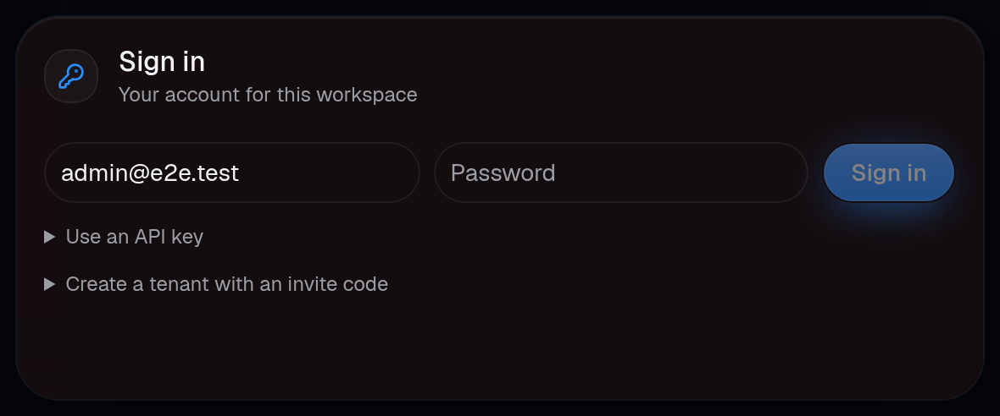

Your account belongs to your company's workspace (the *tenant*); every saved company and every run belongs to it. The bottom of the sidebar shows who is signed in and with which role. The browser remembers the sign-in for seven days and keeps your working draft, so a reload does not lose anything. **Sign out** is in the same card.

| Role | What it can do |
|---|---|
| **viewer** | Look at everything and run simulations. Cannot save companies or runs, delete, or generate. |
| **editor** | Everything a viewer does, plus save, delete and **Generate with Claude**. |
| **admin** | Everything an editor does, plus manage the users of the workspace. |

**Use an API key** (under the Sign in form) is the other way in: paste a key your administrator created. A key acts as an admin and replaces an email sign-in. Use it only if you were given a key instead of an account.

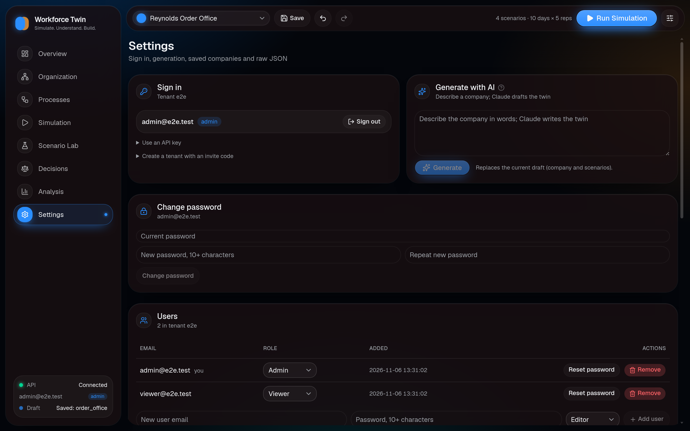

**Change password.** Anyone signed in with an email sees this card. Type the current password, then the new one twice (at least 10 characters) and press **Change password**. Your other sessions, on other computers, are signed out.

**Users** (admins only). The table lists everyone in the workspace. Change a role with the drop-down, set a new password with **Reset password**, or **Remove** someone. To add a person, type their email, a first password of at least 10 characters and a role, then press **Add user**, and tell them the password. The last admin cannot be removed or demoted.

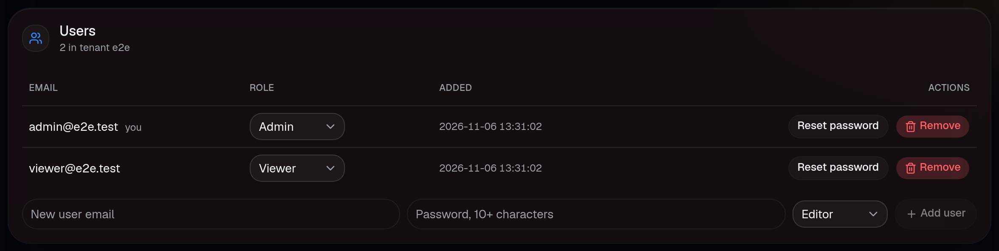

### 2.2 More on Settings

- **Show help hints.** Leave it on while you learn. Every important label has a small question mark; hover it for a one-sentence explanation.

  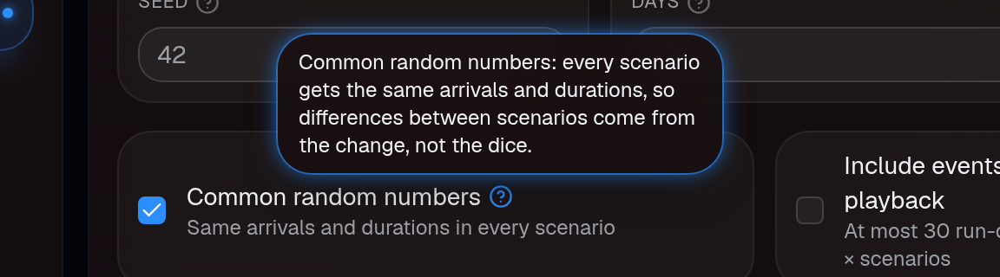

- **Generate with Claude.** Describe the office in a few sentences ("an order desk of six, credit control of two, orders arrive by phone and e-mail, cut-off at 17:00…") and an AI drafts departments, people, workflows and scenarios. You edit everything afterwards. It is the fastest way to get a first draft; it is not required. It needs an editor or admin account.

The example company used in this guide is in `example-company.json` next to this document. On Settings, paste it into the **company** box under **Raw JSON** and press **Apply company** to follow along. Its four scenarios are listed in Section 10; add them on the Scenario Lab page.

---

## 3. Overview

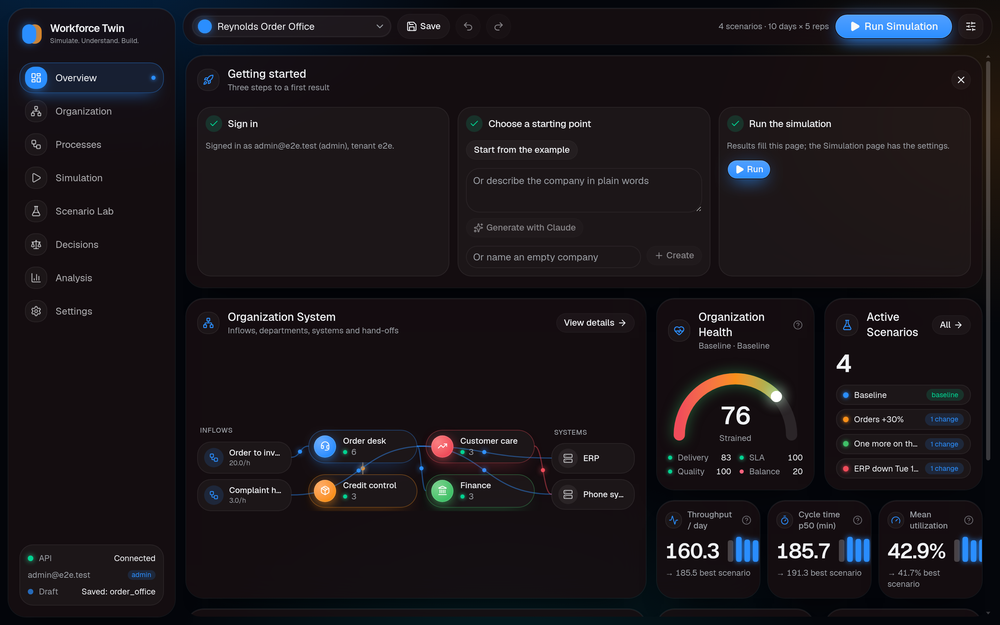

The Overview is the dashboard. At the top, until you close it, is the **Getting started** card with three steps: **Sign in**, **Choose a starting point** (start from the built-in example, describe your office in plain words for **Generate with Claude**, or name an empty company) and **Run the simulation**. A tick marks each step that is done. Close the card with the **×**; **Settings → Help hints → Show getting started** brings it back.

Below it the page shows counts (departments, staff, workflows, scenarios), a health gauge, the **organization map**, the first process as a strip, the active scenarios, and the last run's headline figures with the difference against the baseline.

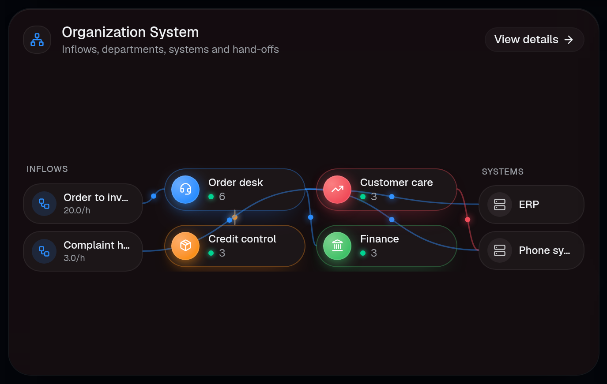

The organization map draws departments as boxes and the hand-offs between them as lines. A hand-off is a step in one department followed by a step in another. The departments are laid out in the order work flows, entry at the top. The thickness of a line is how many hand-offs it carries across all workflows.

**Health** is a single 0–100 score built from four parts of the last run: delivery (share of items completed), SLA (share not breached), quality (share not reworked) and balance (how close staff utilization is to a healthy 75%). It is a quick read, not a target.

---

## 4. Organization

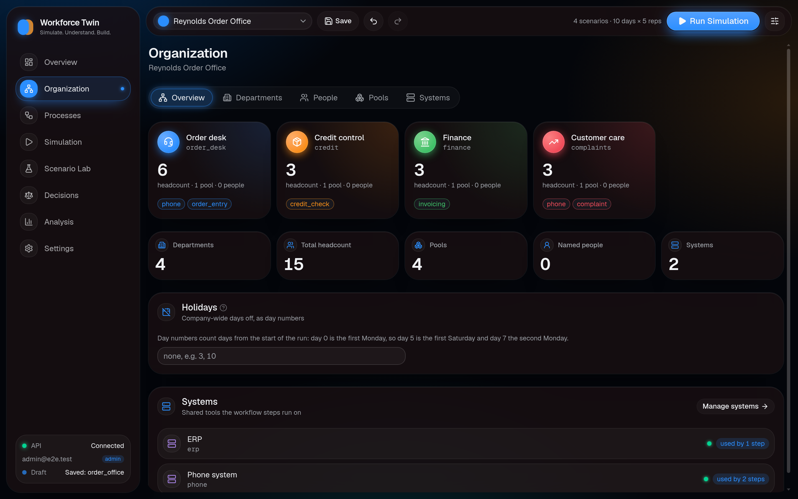

The Organization page is the entry to four tables. Each has an **Add** button and inline editing: click a cell, type, press Tab or click away to commit.

**Holidays** are set on this page too: days when nobody works and nothing arrives, for the whole company. Type them as **day numbers** counted from the start of the run, separated by commas. Day 0 is the first Monday, so day 5 is the first Saturday and day 7 the second Monday. A label under the box shows the weekday each number falls on (`25` shows "day 25 · Fri"). Work already under way when a holiday starts follows the usual end-of-shift rule.

### 4.1 Departments

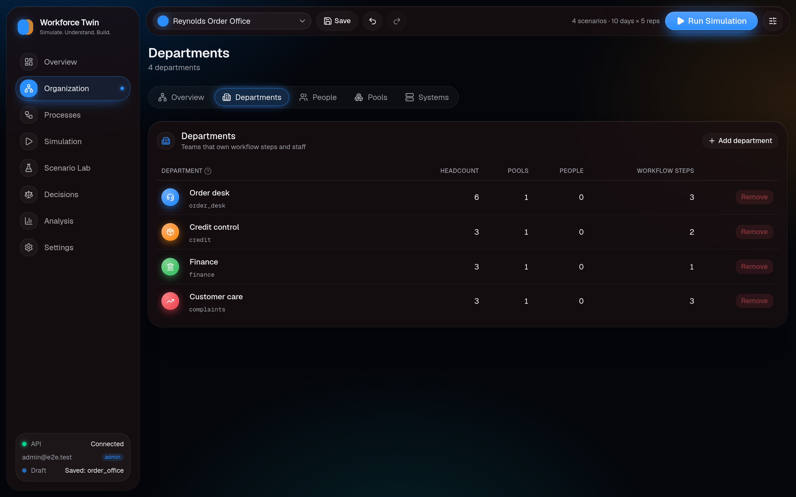

A department is a name and the staff in it. You cannot remove a department while a workflow step or a scenario still refers to it; the Remove button says so.

### 4.2 Pools and People

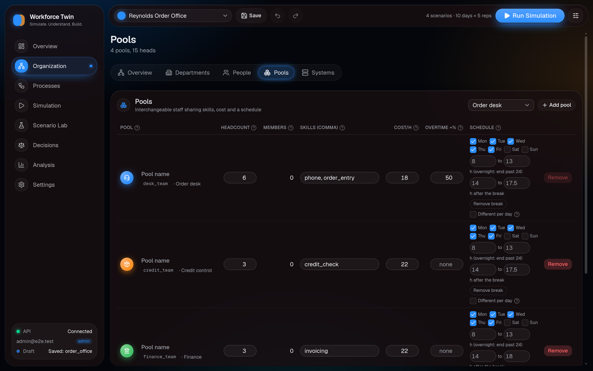

A **pool** is the normal way to describe a team: "the desk team has six people with the skills *phone* and *order_entry*, costs £18 an hour each, and works Monday to Friday 08:00–13:00 and 14:00–17:30".

| Field | What to put |
|---|---|
| **Skills** | Comma-separated labels. A step is picked up only by staff whose skills include the step's required skill. Invent your own labels; keep them consistent. |
| **Cost/h** | Hourly cost of one member. Feeds the *Labor cost* figure. |
| **Overtime +%** | Extra pay for work done outside the schedule. `50` means time and a half. Empty means overtime costs the plain rate. |
| **Headcount** | How many pool members work at the same time. |
| **Schedule** | Working days and hours. **Add break** splits a day into two windows (a lunch break); **Remove break** merges them. Tick **Different per day** to give each weekday its own hours (a short Friday, say); untick it to copy the first working day's hours to every working day. |

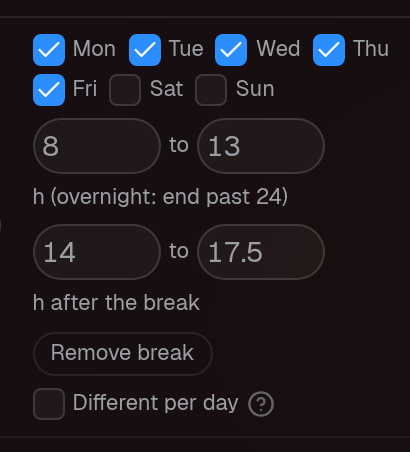

A **person** is a named employee. Use people when individuals matter: a specialist with a unique skill, someone on a different shift, a planned absence. A person can belong to a pool (and then inherit its schedule) or stand alone. People also have a **Speed** multiplier: `2` finishes tasks twice as fast, `0.5` half as fast.

**Absences.** Under a person's schedule, open the collapsed **Absences** section and press **Add absence**. Each absence runs *from day … hour …* *to day … hour …*, counted like holidays: day 0 is the first Monday, and the hour is of that day, so day 2 hour 13.5 is Wednesday 13:30. The weekday is shown next to each day. **Remove** deletes one. (For a one-off absence in a what-if, use the *Absence* overlay in the Scenario Lab instead.)

**Importing people from a CSV file.** With many staff, typing them in is slow. The People page has an **Import people from CSV** card: press **Choose file…** or paste the text into the box. A **preview** shows what would happen to every row before anything changes; nothing is added until you press **Import**.

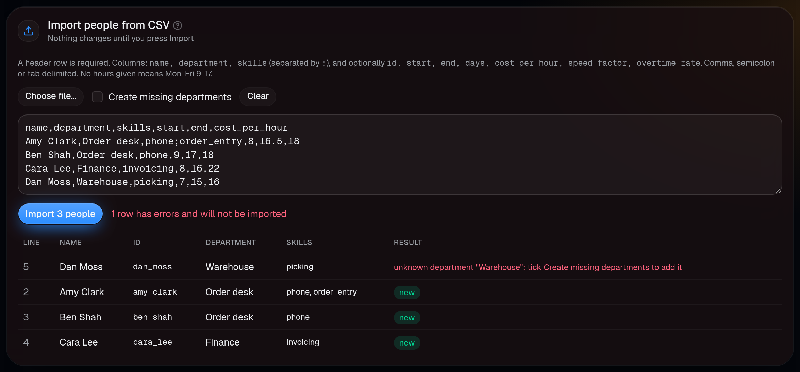

The first row must name the columns. `name`, `department` and `skills` are required; skills are separated by `;`. Optional columns: `id`, `start`, `end` (hours of the day), `days`, `cost_per_hour`, `speed_factor`, `overtime_rate`. Commas, semicolons or tabs all work as separators, so a file saved from Excel is fine. Without hours a person works Monday to Friday, 9 to 17. An example file:

```
name,department,skills,start,end,cost_per_hour
Amy Clark,Order desk,phone;order_entry,8,16.5,18
Ben Shah,Order desk,phone,9,17,18
Cara Lee,Finance,invoicing,8,16,22
```

The Result column says **new**, **skip**, **update** or what is wrong with the row. A department that does not exist is an error unless you tick **Create missing departments**. Someone already in the company is skipped, or updated from the file if you choose so in the preview. Rows with errors are left out; the rest are imported.

### 4.3 Systems

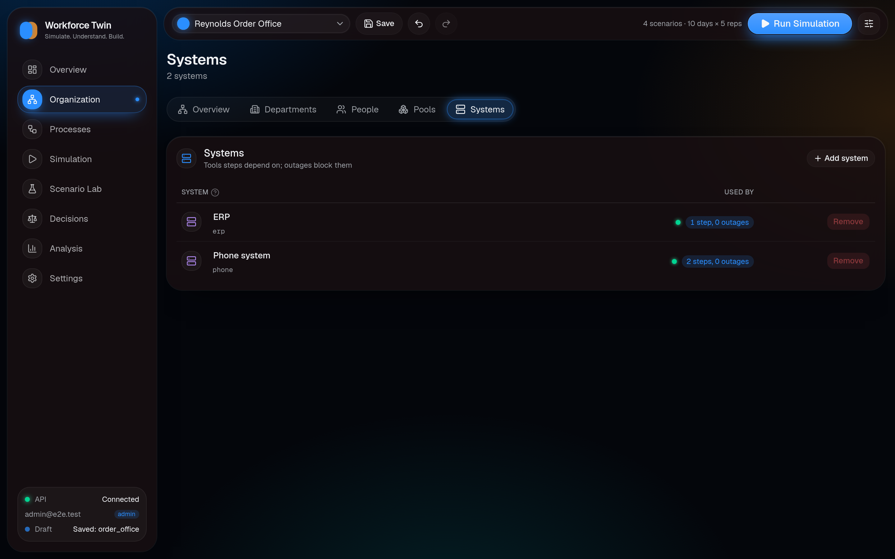

A system is anything a step cannot proceed without: the ERP, the phone system, a label printer. Steps name the system they need. Planned downtime goes on the Scenario Lab page as an **outage**; while a system is down, the steps that need it wait and the time is recorded as blocked.

---

## 5. Processes

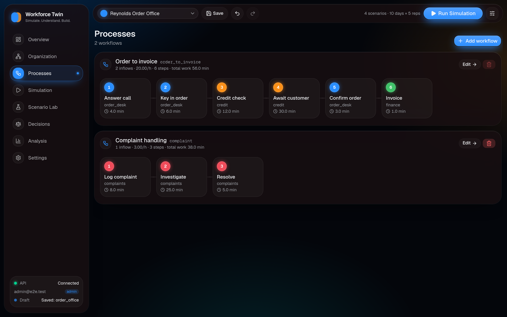

Each card is one workflow with its step chain. **Edit** opens the canvas; **New workflow** creates an empty one. A card also shows the inflow rate and the total working time of the chain.

### 5.1 The canvas

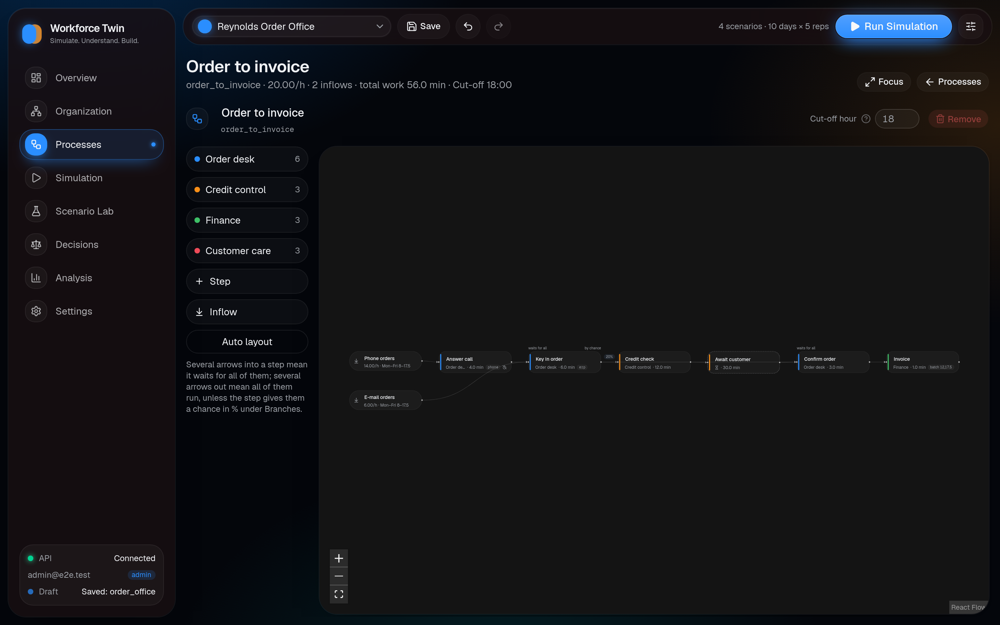

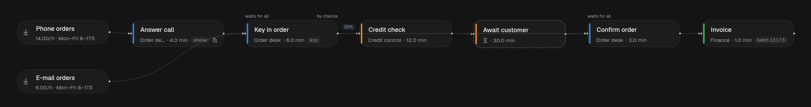

The canvas is where you draw a process while someone describes it. It is deliberately forgiving: a step can exist with only a name; the department, skill and duration can be filled in later. Unfinished steps are marked and the Run button tells you what is missing.

- **Left palette.** Drag a department chip onto the canvas to create a step in that department. Drag the *Inflow* chip to add an entry channel.
- **Boxes** are steps. The colour is the department. The box shows who does it and how long it takes.
- **Arrows** mean "after". Drag from the bottom handle of one step to the top handle of the next. Several arrows into a step mean "after all of these". Two steps with no arrow between them run in parallel.
- **Inflow nodes** are where items enter: "Phone orders", "E-mail orders". Each has its own rate and hours and points at the first step(s) it feeds.
- **Focus** hides the sidebar and top bar; the canvas fits the window.

Click a box to open its **detail panel** on the right.

### 5.2 Step fields

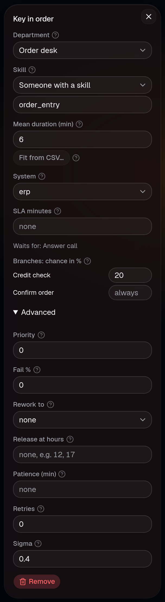

| Field | What to put | Example |
|---|---|---|
| **Name** | What the step is. The id is derived from it. | Key in order |
| **Department** | Who does it. | Order desk |
| **Skill** | Which skill it needs, or **Waiting (nobody works)**. | order_entry |
| **Duration** | Average working minutes for one item. Real times vary around it. **Sigma** is the spread: 0.1 nearly fixed, 1 very variable. 0.4 is a sensible default. | 6 min, sigma 0.4 |
| **Fit from CSV…** | Have the tool derive the average and spread from real measurements: a CSV with one duration (minutes) per row. | |
| **System** | Business system the step needs. | ERP |
| **Branches** | Chance, in percent, that the item goes on to each following step. Steps with a chance are either/or: one of them runs, or none for the remainder up to 100%. Empty means "always". | Credit check 20% |
| **SLA (min)** | Target minutes from arrival to finishing this step. Later counts as a breach. | 60 |
| **Priority** | Higher wins when a worker chooses between waiting tasks under the *priority* policy. | 0 |
| **Fail %**, **Rework to**, **Retries** | Chance the step fails and the item goes back to an earlier step; how many times before it is dropped. | 10%, back to Investigate, 1 retry |
| **Release at hours** | Batch processing: items wait until the next of these hours of day before anyone can pick them up. | 12, 17.5 for invoice runs at noon and 17:30 |
| **Patience (min)** | Average minutes an item waits in the queue before it gives up (a caller hangs up). The item is then **abandoned**. Empty means it waits forever. | 3 |

### 5.3 Waiting steps

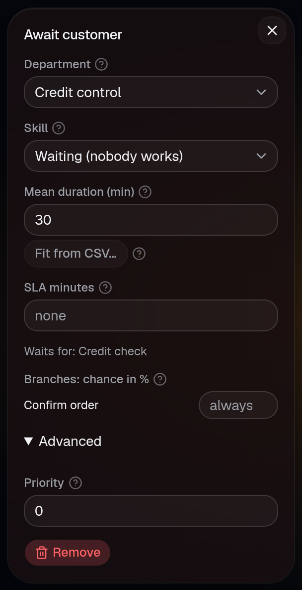

Choose **Waiting (nobody works)** as the skill when time passes but no one in the office is working: waiting for the customer to confirm, for a supplier quote, for a credit reference. The step still belongs to a department (so the waiting time is attributed somewhere) and has a duration, but it uses no staff and never queues. It shows with a dashed border and an hourglass.

### 5.4 Inflows and the demand profile

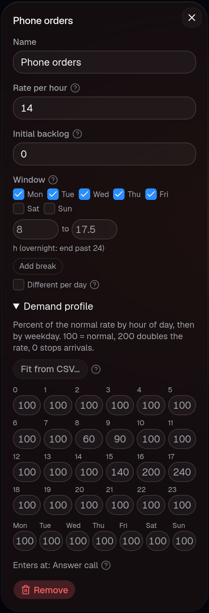

An inflow has a **rate** (average new items per hour while its window is open), a **window** (days and hours when items arrive) and **entry** steps. Work on an item can continue after the window closes; only arrivals stop.

**Initial backlog** is the number of items already waiting when the run starts, for example the orders left over from Friday. `0` means the run starts with an empty office.

Real demand is not flat. Open **Demand profile** to shape it by hour of day and by weekday. Values are **percent of the normal rate**: `100` is normal, `200` doubles the rate in that hour, `0` stops arrivals. A typical order desk might be at 60% at 08:00 and 240% in the hour before cut-off.

**Fit from CSV…** derives the rate and the profile from history: export one timestamp per order from your order system (ISO format such as `2026-10-06T09:14:00`), one per row, and pick the file. The tool reports how many arrivals over how many days it used.

### 5.5 Cut-off hour

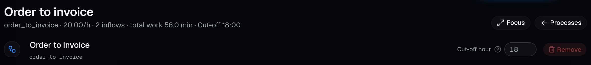

Many office processes are not "done within N minutes" but "done before the cut-off". Set the workflow's **Cut-off hour** (for example `18` when every order must be invoiced by 18:00). Every item that starts before it is due at that hour today; items started after it are due tomorrow. The **Missed cut-off %** figure counts items not finished in time, and the **Earliest due date** policy (Section 7) lets staff work on the most urgent item first.

---

## 6. Scenario Lab

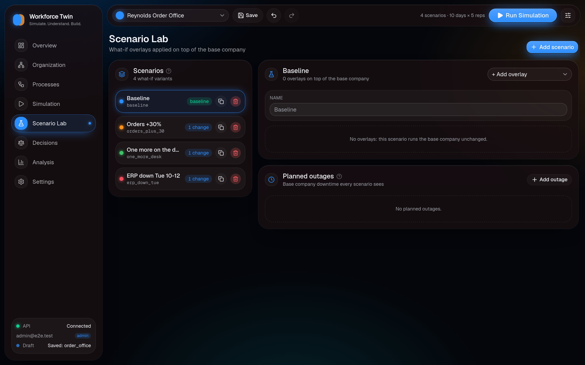

A scenario is the office you drew plus a few **overlays**: changes that apply to that scenario only. **Baseline** has none. Every run simulates all scenarios with the same random draws, so differences between them come from the change, not from chance.

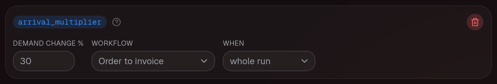

| Overlay | What it does | Example |
|---|---|---|
| **Demand change** | More or less work arrives, for one workflow or all. Enter a percent: `+30` means 30% more items, `-20` means 20% fewer. Optionally only in a **time window** (a seasonal peak: from day 20 to day 40). | Orders +30% |
| **System outage** | A system is down between two moments. Steps that need it wait. | ERP down Tuesday 10:00–12:00 |
| **Add employee** | One more person in a department, with skills, cost, speed and schedule. | A temp on the desk |
| **Remove resource** | A person or a whole pool is gone. | Credit control down to zero |
| **Set pool headcount** | The pool has this many people instead. | Desk team 7 instead of 6 |
| **Absence** | A person is away between two moments. | Sick day on Wednesday |

The page also lists the base company's **planned outages**, which every scenario sees.

Scenarios also come from the Decisions page (Section 9): the optimizer and the sweep can each **Add as scenario** what they found.

Good scenarios change **one thing** each. "Orders +30%" tells you whether the desk copes with growth. "One more on the desk" tells you what the extra person buys. Both at once tells you less.

---

## 7. Simulation

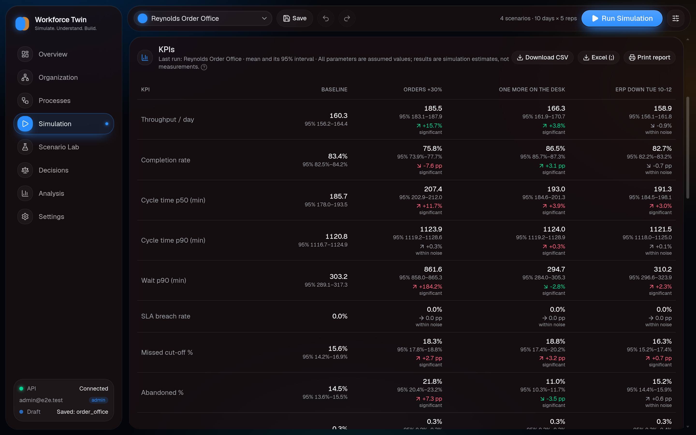

This is where you run. The settings card at the top:

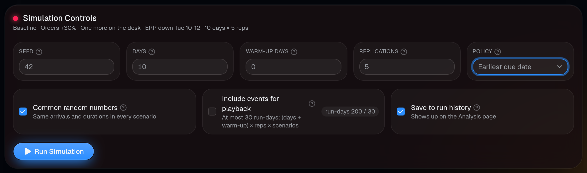

| Setting | Meaning | Advice |
|---|---|---|
| **Seed** | Starting point of the random draws. The same seed gives the same result. | Leave it; change it to see a different random week. |
| **Days** | Simulated days per run. | 10–30. Short runs are noisy. |
| **Warm-up days** | Extra days simulated *before* measuring starts, so the office is not empty at the start. Figures cover only the days after the warm-up. | 0 when you start with an **Initial backlog**; otherwise a few days. Use **7** when you compare with a run without warm-up, so the measured days start on the same weekday. |
| **Replications** | How many times each scenario is re-run with different draws. Figures are averaged. | **At least 5**; 5–10 is usual. More is surer but slower. |
| **Policy** | How a free worker picks the next task. *priority*: highest step priority first. *fifo*: oldest first. *least_loaded*: longest queue first. *edd* (earliest due date): the item whose cut-off is soonest first. | *edd* when you use cut-offs; otherwise *priority*. |
| **Common random numbers** | Every scenario gets the same arrivals and the same working times, so the comparison isolates your change. | Leave on. |
| **Include events for playback** | Records every event so you can replay the run step by step. Only for short runs ((days + warm-up) × reps × scenarios ≤ 30). | Off for comparisons, on when you want to watch a day unfold. |
| **Save to run history** | Stores the result on the server so it appears under **Run history** on Analysis. Viewers cannot save. | On once the model is stable. |

Press **Run Simulation**. While it runs, the top bar shows a progress bar ("21 of 80 replications") and a **Cancel** button; cancelling keeps the previous result.


When it finishes, the page shows the **KPIs** table, the **Recommendations** (Section 8.1), a **blocked-time ledger** (where items waited and why: off shift, everyone busy, system down, batch hold) and, if you recorded events, a **Playback** card with a time slider.

There is a limit on run size ((days + warm-up) × replications × scenarios, by default 2000 run-days). If you exceed it the error message tells you the numbers.

### 7.1 How sure is a number?

Each run draws random arrivals and working times, so two runs never give exactly the same figure. That is why each scenario is run several times (the *replications*) and averaged. In the KPIs table every figure has three parts:

- the **mean**, in bold: the average over the replications. This is the estimate;
- **95%** followed by a range, such as `95% 156.2–164.4`: the **95% interval**. It says how sure the simulation is of its own mean: if you ran the same scenario thousands of times, the long-run average would very probably (95 times in 100) fall inside this range. A narrow range means the figure is settled; a wide one means run more replications;
- for every scenario after the first, the **change against the baseline**, with one of three labels:
  - **significant**: the change is larger than the random variation between runs. Treat it as a real effect of what you changed.
  - **within noise**: the runs cannot tell this change apart from chance. Do not read it as a gain or a loss, however large the number looks.
  - **negligible** (no colour, no arrow): the change is so small that it rounds to zero, so there is nothing to read in it.

The change is judged run by run (each replication of a scenario against the same replication of the baseline), so a change can be significant even when the two 95% ranges overlap.

With **one replication** there is no interval and every change counts as *within noise*. With two to four the interval is very wide. Use **at least 5 replications** before you trust a difference; 10 if two options are close.

The interval is about chance only. It does not say whether the model is right: that depends on your inputs (see the reality check in Section 8.2).

---

## 8. Analysis

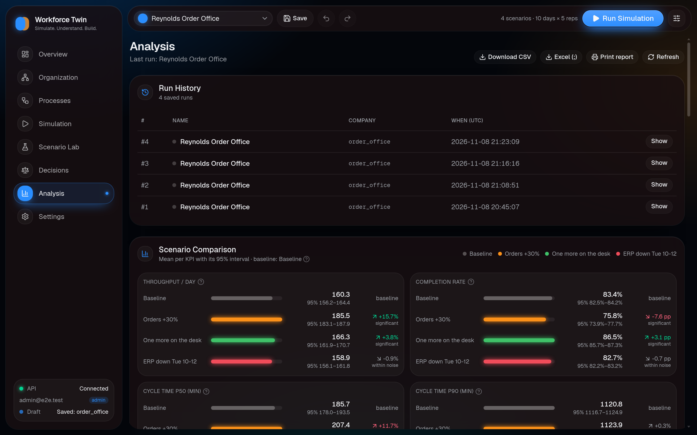

Analysis compares the scenarios of the last run (or of a saved run: pick it under **Run history** and press **Show**). **Scenario Comparison** shows each figure as bars, one per scenario, with its mean, 95% interval and the change against the first scenario, labelled *significant* or *within noise* as explained in Section 7.1.

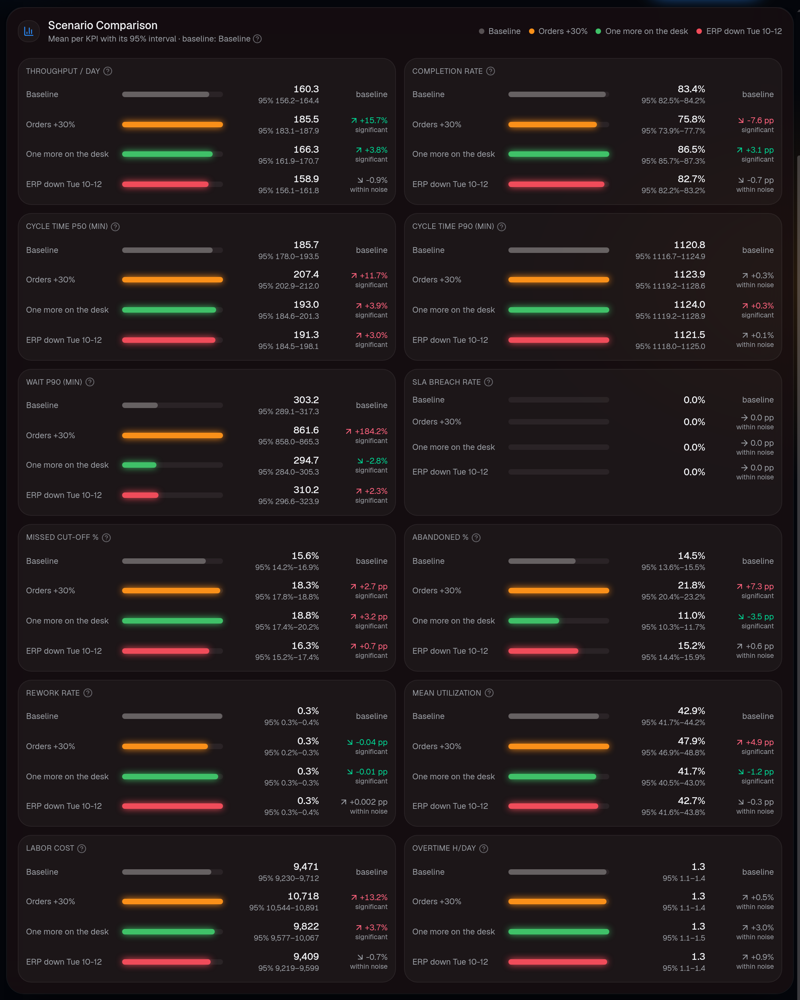

| Figure | Plain meaning | Read it as |
|---|---|---|
| **Throughput / day** | Items completed per simulated day. | Higher is better. If it is below what arrives per day, a backlog is building. |
| **Completion rate** | Share of arrived items that finished within the run. | Below 100% means the office does not keep up. |
| **Cycle time p50 / p90** | Half of the items finish within p50 minutes; 90% within p90. Includes queueing, waiting steps and nights. | p90 is what your slowest normal customers experience. |
| **Wait p90** | 90% of waits for a free worker are shorter than this. | The queue, on its own. |
| **SLA breach rate** | Share of step executions finished after their SLA target. | |
| **Missed cut-off %** | Share of items not finished by the workflow's cut-off hour. | The order-desk number. |
| **Abandoned %** | Share of items that gave up waiting (patience ran out). | Lost calls. |
| **Rework rate** | Share of step executions that failed and were redone. | |
| **Mean utilization** | Busy share of staff during their shifts. | Around 75% is healthy. Near 100% is a bottleneck; below 50% is spare capacity. |
| **Labor cost** | Hours worked × hourly cost, overtime at the overtime rate. | |
| **Overtime h/day** | Hours worked outside schedules per day, all staff. | |
| **Cost per completed** | Labor cost ÷ completed items. | The efficiency figure. |

Further down: **utilization per department**, which shows where the bottleneck is, and the **Workflow breakdown**, one row per workflow and entry channel, so you can see that phone orders miss the cut-off while e-mail orders do not.

### 8.1 Recommendations

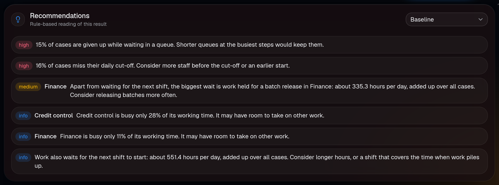

The **Recommendations** card reads the result for you, one scenario at a time (pick it at the top right). Each line has a level: **high** for a serious problem (many items given up or past the cut-off), **medium** for a clear bottleneck, **info** for something worth knowing, such as a department that is busy only a quarter of its time. Waits are given in **hours per day, added up over all cases**: twenty orders that each wait an hour make 20 hours. The line that starts *Apart from waiting for the next shift, the biggest wait is…* names the largest wait you can act on (a busy department, a system outage, a batch release). *Work also waits for the next shift to start* is the time items sit overnight or through a break; only longer or moved working hours shorten it. The lines come from fixed rules, not from an AI. They point at where to look; they are not decisions.

### 8.2 Reality check

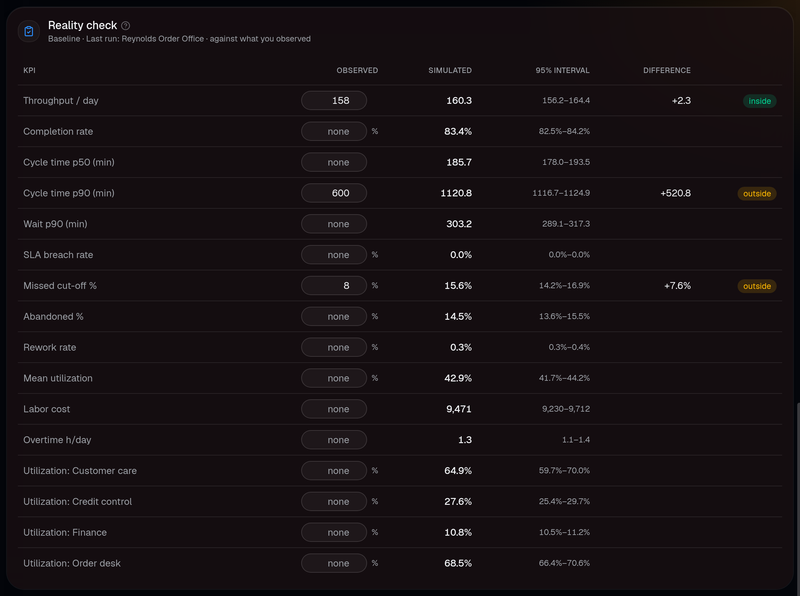

Before you trust the what-ifs, check that the baseline looks like your real office. In the **Reality check** card, type in the **Observed** column what you measured in real life for a few figures: last month's orders per day, the share that missed the cut-off, and so on. Leave the others empty. Percentages are typed as percent (`8` for 8%).

For each figure you fill in, the card shows the simulated mean, its 95% interval, the difference and a verdict:

- **inside**: your real value falls inside the simulated interval. The model agrees with reality on this figure.
- **outside**: it does not. A small miss is normal. A **big gap** (in the picture, cycle time p90 of 600 minutes observed against 1121 simulated) means the inputs need calibrating before the what-ifs can be trusted: check arrival rates, step durations, staffing and schedules (Section 11).

The observed values are saved with the company, so they are there next time.

### 8.3 Exporting and printing

The buttons at the top of Analysis (also on the KPIs card of Simulation):

- **Download CSV**: all figures of the shown result as a file for a spreadsheet.
- **Excel (;)**: the same, with semicolons and decimal commas, for Excel set to a language such as Turkish, where a plain CSV opens in one column.
- **Print report**: a print-friendly page with the run settings, the assumptions, the figures, the recommendations and the longest waits. Use the browser's print dialog (Ctrl+P) and choose **Save as PDF** to get a PDF.
- **Refresh** reloads the run history and saved companies.

---

## 9. Decisions

The Decisions page answers two questions that would take many hand-made scenarios: *how many people do we need?* and *at what point does it start to hurt?* Both run in the background with a progress bar and **Cancel**, and they do not replace the main result on Simulation and Analysis. They use the run settings of the Simulation page (days, replications, policy).

### 9.1 Staffing optimizer

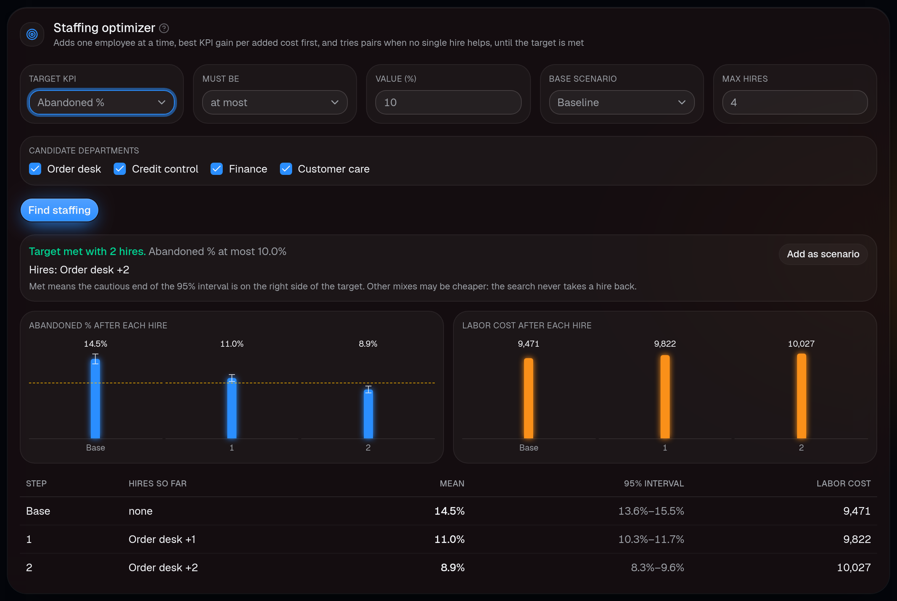

You state a target; the optimizer looks for the cheapest set of extra hires that meets it.

| Field | What to put | Example |
|---|---|---|
| **Target KPI** | The figure that must reach the target. Department utilization is also on the list. | Abandoned % |
| **Must be** | **at most** (for figures where lower is better) or **at least**. | at most |
| **Value** | The target, in percent for percentage figures. | 10 |
| **Base scenario** | The scenario to start from. | Baseline |
| **Max hires** | The most people it may add before it gives up. | 4 |
| **Candidate departments** | Departments where it may hire. Untick those that cannot grow. | all four |

Press **Find staffing**. It adds people **one at a time**: each round it tries one more person in every candidate department and keeps the hire that improves the figure most for the money. When no single hire helps, it tries **pairs** of hires. It stops when the target is met, when **Max hires** is reached, or when nothing helps. A new person copies the skills, schedule and cost of the first person or pool in that department.

**Reading the result.** "Target met with 2 hires. Hires: Order desk +2" means two more people on the order desk are enough. *Met* is cautious: the whole 95% interval must be on the right side of the target, not just the mean. The charts and the table show the figure and the labour cost after each hire, so you can see what each extra person buys. If the target is not met, a sentence says why (the hire limit, the run budget, or no hire helped).

Press **Add as scenario** to put the result in the Scenario Lab, then run it on Simulation with the other scenarios.

### 9.2 Parameter sweep

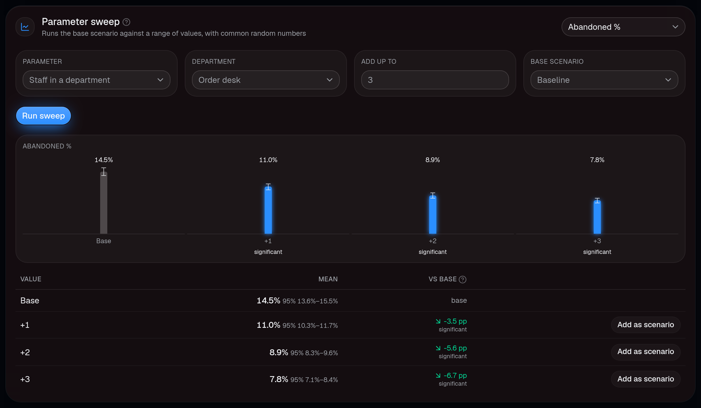

A sweep runs the base scenario several times with one thing changed step by step, and draws the result. **Parameter** is either:

- **Staff in a department**: pick the **Department** and **Add up to** (3 runs +1, +2 and +3 people); or
- **Demand**: list the **Change (%)** values, such as `+10%, +20%, +30%`, for one **Workflow** or all.

Pick the **KPI** to draw and press **Run sweep**. The chart shows the mean and its interval for each value, with the base in grey; the table shows the change against the base, *significant* or *within noise*. You can switch the KPI afterwards with the drop-down at the top right without running again. Look for the point where the line bends: that is where more staff stops paying, or where more demand starts to hurt. **Add as scenario** on a row puts that point in the Scenario Lab.

---

## 10. A worked example: the order desk

Rebuild this in ten minutes to get a feel for the tool. (The company is the `example-company.json` next to this guide; you can also paste that on Settings and add the four scenarios below.)

**The office.** Four departments:

- *Order desk*: pool of 6, skills `phone, order_entry`, £18/h, overtime +50%, Mon–Fri 08:00–13:00 and 14:00–17:30.
- *Credit control*: pool of 3, skill `credit_check`, £22/h, same hours.
- *Finance*: pool of 3, skill `invoicing`, £22/h, Mon–Fri 08:00–13:00 and 14:00–18:00.
- *Customer care*: pool of 3, skills `phone, complaint`, £19/h.

Two systems: *ERP*, *Phone system*.

**Workflow "Order to invoice"**, cut-off 18:00 (every order must be invoiced by six), two inflows:

- *Phone orders*: 14/hour, Mon–Fri 08:00–17:30, demand profile 60% at 08:00 rising to 240% at 17:00. Entry: *Answer call*.
- *E-mail orders*: 6/hour, same hours. Entry: *Key in order*.

Steps:

1. **Answer call** — Order desk, `phone`, 4 min, Phone system, **patience 3 min** (callers hang up after about three minutes).
2. **Key in order** — Order desk, `order_entry`, 6 min, ERP. **Branch: 20% → Credit check.**
3. **Credit check** — Credit control, `credit_check`, 12 min.
4. **Await customer** — Credit control, **Waiting (nobody works)**, 30 min.
5. **Confirm order** — Order desk, `order_entry`, 3 min, after *Key in order* and *Await customer*.
6. **Invoice** — Finance, `invoicing`, 1 min, **release at 12 and 17.5** (invoices go out in two daily runs, at noon and 17:30).

**Workflow "Complaint handling"**: 3/hour, Mon–Fri 9–17. *Log complaint* (Customer care, `phone`, 8 min) → *Investigate* (`complaint`, 25 min, fails 10% and is redone once) → *Resolve* (`phone`, 5 min).

**Scenarios:** Baseline · Orders +30% (order workflow only) · One more on the desk (headcount 7) · ERP down Tuesday 10:00–12:00.

**Run** with 10 days, warm-up 0, 5 replications, policy *edd*, common random numbers on.

**How to read the result.** Look at the order workflow's *Missed cut-off %* and *Abandoned %* across the four scenarios. In the baseline about one order in six misses the 18:00 cut-off and about one caller in seven hangs up. Nearly every missed order arrived in the 16:00–17:30 peak: by the time it has been keyed in, credit-checked and confirmed, the desk has closed. "One more on the desk" cuts the hang-ups but does not improve the cut-offs; it even raises them a little, because more calls get answered and more orders reach the afternoon bottleneck. That tells you the desk is not the constraint for lateness; the afternoon peak and the credit path are. "Orders +30%" raises hang-ups further. The ERP outage shows up as a bulge of blocked time in the ledger on Tuesday and a dip in that day's throughput. The next scenarios to try are the ones the result suggests: a later cut-off, an extra invoice run, or a shorter customer wait.

All these changes are marked *significant* on Analysis: with 5 replications they are larger than the noise. The ERP outage's effect on throughput is *within noise*: two hours on one Tuesday hardly shows over ten days.

**Asking the Decisions page.** On Decisions, set the optimizer to *Abandoned % at most 10*, all four departments as candidates, max hires 4. It answers "Target met with 2 hires: Order desk +2": two more people on the desk bring hang-ups down to about 9%. Press **Add as scenario** and run again to see what those two people do to the cut-off figure. A staff sweep on the Order desk (+1 to +3), drawn for Abandoned %, shows hang-ups falling from 14.5% to 11.0%, 8.9% and 7.8%: each extra person still helps, but less than the one before.

Then change one number and run again. That loop is the whole tool.

---

## 11. Getting real numbers in

The model is only as good as its inputs. In order of value:

1. **Arrival rates and profile.** Export one timestamp per order/call for four normal weeks and use **Fit from CSV…** on the inflow. This is the single biggest improvement over a guess.
2. **Step durations.** Ten honest stopwatch measurements per step are enough for **Fit from CSV…** on the duration. Use the *working* time, not the elapsed time; queueing is what the simulation adds.
3. **Branch percentages.** Count how many orders went to credit check last month, divided by all orders.
4. **Schedules, headcounts, cut-offs.** You already know these.
5. **Patience.** Your phone system's abandoned-call report gives the average time to hang-up.
6. **Check against reality.** Type a few real figures into the **Reality check** on Analysis (Section 8.2). Where the simulation is far outside, fix the inputs above first, before you trust a what-if.

Everything else (failure rates, overtime, outages) can start as a round-number guess and be refined when a result looks wrong.

---

## 12. Saving, loading and sharing

- **Save** (top bar) stores the draft under its company id on the server, in your workspace. The company picker in the top bar lists saved companies and the built-in *Reynolds* example. Viewers cannot save.
- **Autosave.** Once a company has been saved, every later change is saved by itself a moment after you stop typing. The **Draft** line at the bottom of the sidebar says where things stand: *Unsaved* (never saved, press Save), *Saving…*, *Saved: order_office*, *Save failed* (with the reason underneath), or *Edit conflict*.
- **Undo and redo.** The arrow buttons next to Save, or **Ctrl+Z** and **Ctrl+Shift+Z**, step back and forward through your changes to the company and its scenarios. Inside a text box the same keys undo your typing first.
- The browser keeps your working draft between visits. If a draft ever fails to load (for example after an update that tightened a rule), it is kept under a separate key and an error tells you; nothing is silently lost.
- **Settings → Raw JSON** shows the whole company and scenarios as text. Copy it to share a model with a colleague; they paste it and press **Apply company** and **Apply scenarios**. **Download (.json)** saves the same as a file.

### 12.1 When someone else saved first

If a colleague saves the same company while you are working on it, your next save would overwrite their work. The tool stops instead: a message at the top says **Someone else saved … since you loaded it**, autosave pauses, and the sidebar shows *Edit conflict*.

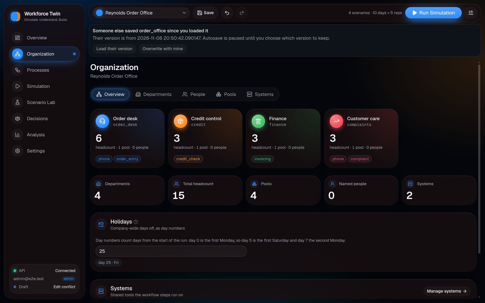

Choose one:

- **Load their version**: drop your unsaved changes and continue from what your colleague saved.
- **Overwrite with mine**: save your version over theirs. Their changes are lost, so agree with them first.

---

## 13. Limits and good habits

- All figures are **estimates from assumptions**. Use them to compare options, not to promise a service level. The 95% interval covers chance only, not wrong inputs; use the reality check.
- Start small: one workflow, the real departments, round numbers. Run. Only then add detail where the result is sensitive to it.
- Change **one thing per scenario**.
- Run **at least 5 replications** before trusting a difference. **One replication gives no interval**, and every change then shows as *within noise*.
- A run that starts empty takes a day or two to fill up; use warm-up days, an initial backlog, or 10 days or more.
- The **optimizer** adds one hire at a time and, when no single hire helps, tries pairs. It therefore misses a case where **three departments must grow together**, and it **never removes a hire** it has made, so a cheaper mix may exist. Treat its answer as a good starting point and check alternatives as scenarios.
- **Runs, optimizer and sweep jobs live on the server only while they run.** If the server restarts during a run, that run is lost; start it again. Saved runs in the run history are kept.
- Hours outside the schedule: a task that is running at shift end is finished (at overtime cost); new tasks wait for the next shift.
- Weekends: nothing arrives unless an inflow window says so; staff are off unless a schedule says so.
