# Workforce Twin — Kullanıcı Kılavuzu

Workforce Twin, **işin bir ofiste nasıl aktığını gösteren bir simülasyondur**. Ofisi bir kez tarif edersiniz: orada kim çalışıyor, ne zaman çalışıyor, hangi sistemleri kullanıyor, bir sipariş ya da şikâyet hangi adımlardan geçiyor. Araç bu ofisi belirli sayıda simüle gün boyunca, defalarca "oynatır" ve olanları raporlar: siparişler ne kadar hızlı tamamlandı, nerede kuyruk oluştu, kimin üzerinde yük fazlaydı, kaç tanesi kesim saatini kaçırdı.

Ardından tek bir şeyi değiştirirsiniz (siparişler %30 artar, masaya bir kişi daha eklenir, ERP iki saat çöker) ve yeniden çalıştırırsınız. İki çalıştırma arasındaki fark, "ya şöyle olursa" sorunuzun cevabıdır.

Bu araçtaki hiçbir şey gerçek ofisin ölçümü değildir. **Her sayı sizin girdiğiniz bir varsayımdır.** Her sonuç da bu varsayımlardan çıkan bir tahmindir. Araç bunu her sonuç ekranında belirtir.

Bu kılavuz, uygulamayı hiç görmemiş kişiler içindir. Ekranları tek tek gezer, her alanı gündelik bir dille açıklar. Sonunda on dakikada yeniden kurabileceğiniz çözümlü bir örnek vardır.

---

## 1. Temel fikirler

Ekranlara geçmeden önce, her yerde göreceğiniz altı kelime.

| Kelime | Burada ne anlama gelir | Örnek |
|---|---|---|
| **Department** (Departman) | Aynı tür işi yapan personel grubu. | Order desk, Credit control, Finance |
| **Pool / Person** (Havuz / Kişi) | İşi kim yapar. *Havuz (pool)* "birbirinin yerine geçebilen 6 kişi" demektir; *kişi (person)* ise adı belli tek bir çalışandır. İkisinin de becerileri, çalışma saatleri ve saatlik maliyeti vardır. | Desk team ×6 |
| **Skill** (Beceri) | Bir adımı kimin yapabileceğini belirten etiket. Her adım tek bir beceri ister; adımı yalnızca o beceriye sahip personel alır. | phone, order_entry, credit_check |
| **System** (Sistem) | Bir adımın bağlı olduğu yazılım ya da ekipman. Sistemler çökebilir. | ERP, Phone system |
| **Workflow** (İş akışı) | Baştan sona tek bir iş türü; adımlar hâlinde çizilir. | "Order to invoice", "Complaint handling" |
| **Scenario** (Senaryo) | Çizdiğiniz ofis artı birkaç değişiklik. *Baseline* (Temel) senaryoda hiçbir değişiklik yoktur. Her çalıştırma tüm senaryoları simüle eder; böylece onları karşılaştırabilirsiniz. | "Orders +30%", "One more on the desk" |

Bir çalıştırma şöyle işler: yeni kalemler (siparişler, aramalar, şikâyetler) belirlediğiniz hızla **gelir**. Her kalem iş akışının (workflow) **adımlarından** geçer. Bir adım, doğru beceriye sahip biri boşa çıkıp vardiyada olana kadar kuyrukta bekler. Sonra verdiğiniz ortalamanın çevresinde rastgele bir süre alır. Bir sisteme bağlı kalemler, o sistem çöktüğü sürece bekler. Sonunda araç her şeyi sayar.

Saat **Pazartesi 00:00**'da başlar. Kesintiler gibi zamanlar bu andan itibaren dakika olarak girilir. Ekranlar bunun hangi gün ve saate denk geldiğini gösterir.

---

## 2. Giriş

Yöneticinizin verdiği web adresini açın. Soldaki kenar çubuğunda sayfalar listelenir. Üst çubukta şirket seçici, **Save** (Kaydet) ve **Run** (Çalıştır) bulunur.

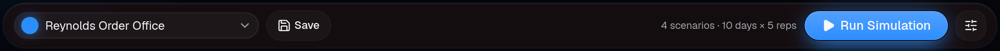

İlk seferde **Settings** (Ayarlar) sayfasına gidin ve size verilen **API key** (API anahtarı) değerini yapıştırın. Anahtar, şirketinizin çalışma alanını tanımlar; kaydedilen her şirket ve her çalıştırma bu alana aittir. Tarayıcı anahtarı ve üzerinde çalıştığınız taslağı hatırlar. Sayfayı yenilediğinizde hiçbir şey kaybolmaz.

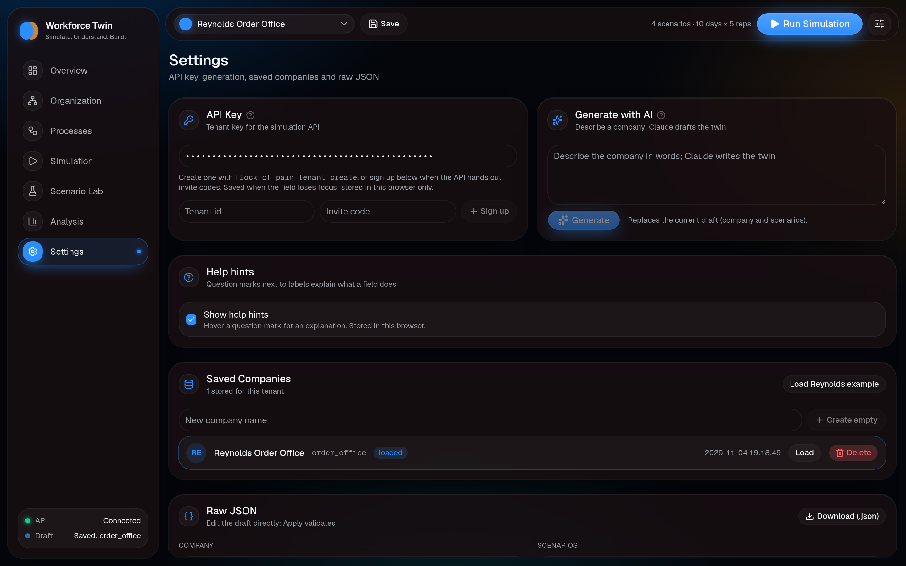

Settings sayfasında iki şey daha var:

- **Show help hints** (Yardım ipuçlarını göster). Öğrenirken açık bırakın. Her önemli etiketin yanında küçük bir soru işareti vardır. Üzerine gelince tek cümlelik bir açıklama görürsünüz.

  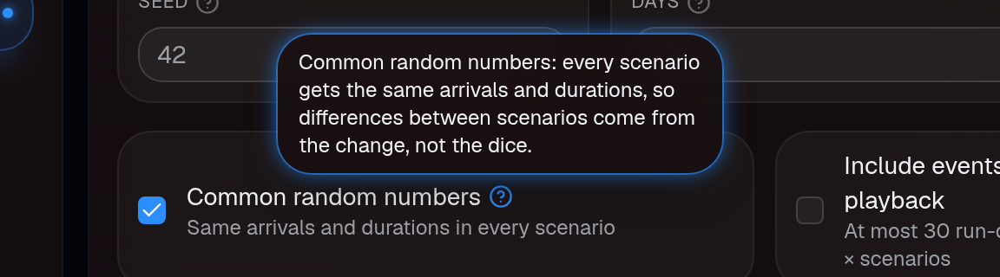

- **Generate with Claude** (Claude ile oluştur). Ofisi birkaç cümleyle anlatın ("altı kişilik bir order desk, iki kişilik credit control, siparişler telefon ve e-postayla gelir, kesim saati 17:00…"). Yapay zekâ departmanların, kişilerin, iş akışlarının ve senaryoların bir taslağını hazırlar. Sonra her şeyi düzenleyebilirsiniz. İlk taslağa ulaşmanın en hızlı yoludur, ama zorunlu değildir.

Bu kılavuzda kullanılan örnek şirket, bu belgenin yanındaki `example-company.json` dosyasındadır. Adım adım takip etmek için Settings sayfasında bu dosyayı ham JSON kutusuna yapıştırın ve **Apply** (Uygula) düğmesine basın.

---

## 3. Overview

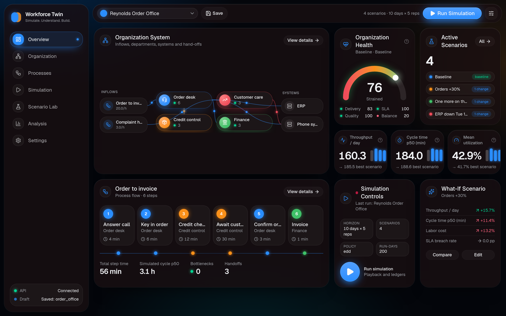

**Overview** (Genel Bakış) gösterge panelidir. Sayıları (departmanlar, personel, iş akışları, senaryolar), bir sağlık göstergesini, **organization map** (organizasyon haritası) görünümünü, ilk süreci bir şerit hâlinde, etkin senaryoları ve son çalıştırmanın öne çıkan rakamlarını temel senaryoya göre farklarıyla gösterir.

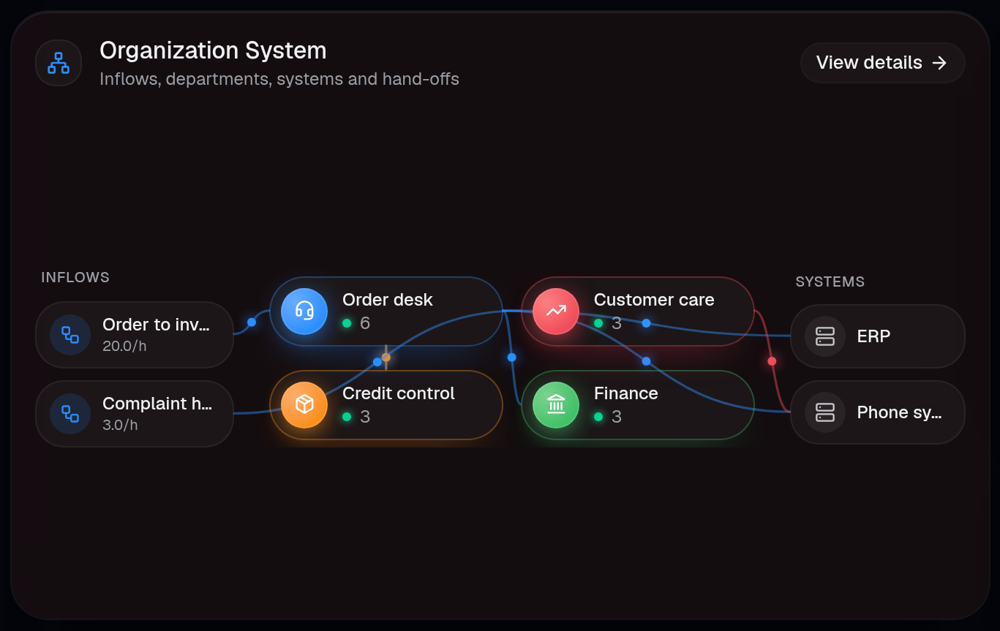

Organization map, departmanları kutular, aralarındaki devirleri de çizgiler olarak çizer. Devir, bir departmandaki adımın ardından başka bir departmandaki adımın gelmesidir. Departmanlar işin aktığı sıraya göre dizilir; giriş en üsttedir. Bir çizginin kalınlığı, tüm iş akışlarında o çizgiden kaç devir geçtiğini gösterir.

**Health** (Sağlık), son çalıştırmanın dört bölümünden üretilen 0–100 arası tek bir puandır: teslimat (tamamlanan kalemlerin payı), SLA (ihlal edilmeyenlerin payı), kalite (yeniden işleme girmeyenlerin payı) ve denge (personel doluluğunun sağlıklı %75 düzeyine ne kadar yakın olduğu). Hızlı bir okuma içindir, hedef değildir.

---

## 4. Organization

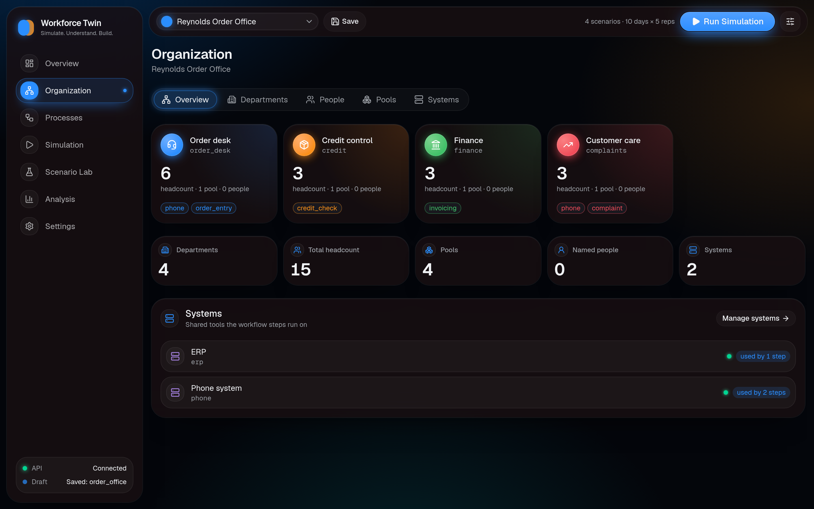

**Organization** (Organizasyon) sayfası dört tabloya açılır. Her tablonun bir **Add** (Ekle) düğmesi vardır ve satır içinde düzenlenebilir: bir hücreye tıklayın, yazın, kaydetmek için Tab'a basın ya da başka bir yere tıklayın.

### 4.1 Departments

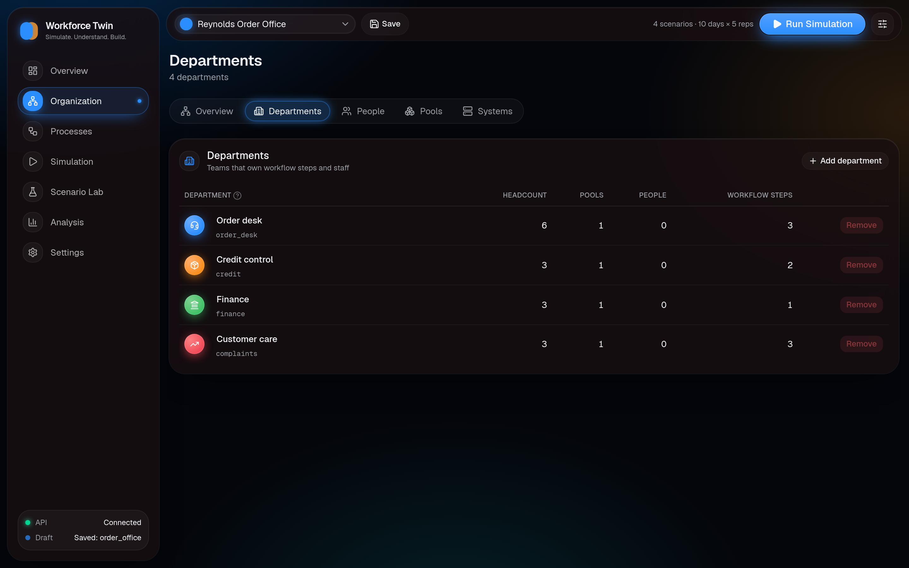

Bir departman, bir addan ve içindeki personelden oluşur. Bir iş akışı adımı ya da senaryo hâlâ bir departmana başvuruyorsa o departmanı silemezsiniz. **Remove** (Kaldır) düğmesi bunu size söyler.

### 4.2 Pools and People

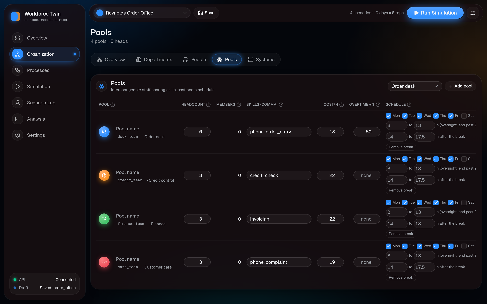

Bir ekibi tarif etmenin olağan yolu **pool** (havuz) kullanmaktır: "desk team altı kişiden oluşur, *phone* ve *order_entry* becerilerine sahiptir, kişi başı saatte £18'a mal olur ve Pazartesi–Cuma 08:00–13:00 ile 14:00–17:30 arasında çalışır".

| Alan | Ne girilir |
|---|---|
| **Skills** (Beceriler) | Virgülle ayrılmış etiketler. Bir adımı yalnızca becerileri o adımın istediği beceriyi içeren personel alır. Etiketleri kendiniz uydurun, ama tutarlı tutun. |
| **Cost/h** (Saatlik maliyet) | Bir üyenin saatlik maliyeti. *Labor cost* (İşçilik maliyeti) rakamını besler. |
| **Overtime +%** (Fazla mesai +%) | Çalışma planı dışında yapılan iş için ek ücret. `50`, normal ücretin bir buçuk katı demektir. Boş bırakılırsa fazla mesai normal ücretle hesaplanır. |
| **Headcount** (Kişi sayısı) | Havuzun kaç üyesinin aynı anda çalıştığı. |
| **Schedule** (Çalışma planı) | Çalışma günleri ve saatleri. **Add break** (Mola ekle) bir günü iki zaman aralığına böler (öğle arası). **Remove break** (Molayı kaldır) bunları birleştirir. |

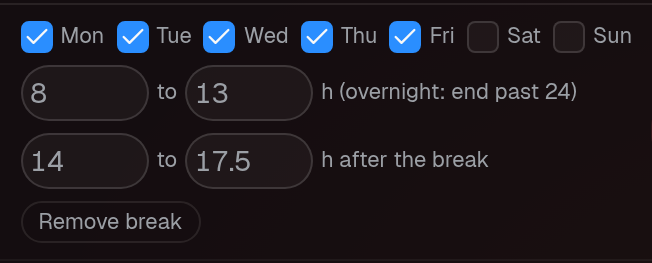

**Person** (kişi), adı belli bir çalışandır. Bireylerin önemli olduğu durumlarda kişi kullanın: benzersiz bir beceriye sahip bir uzman, farklı vardiyada çalışan biri, planlı bir izin. Bir kişi bir havuza ait olabilir (bu durumda havuzun çalışma planını devralır) ya da tek başına durabilir. Kişilerin bir de **Speed** (Hız) çarpanı vardır: `2` görevleri iki kat hızlı, `0.5` yarı hızda bitirir.

### 4.3 Systems

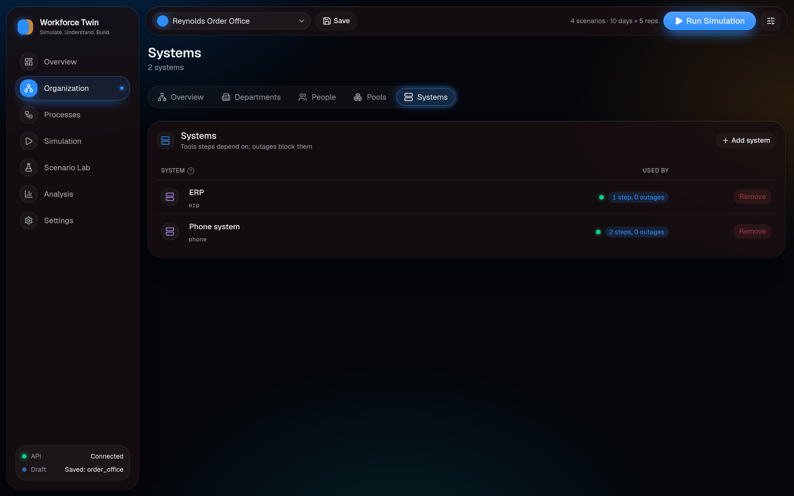

Sistem, bir adımın onsuz ilerleyemediği her şeydir: ERP, telefon sistemi, bir etiket yazıcısı. Adımlar ihtiyaç duydukları sistemi belirtir. Planlı kesintiler **Scenario Lab** (Senaryo Laboratuvarı) sayfasına **outage** (kesinti) olarak girilir. Bir sistem çöktüğü sürece ona ihtiyaç duyan adımlar bekler ve bu süre engellenmiş süre olarak kaydedilir.

---

## 5. Processes

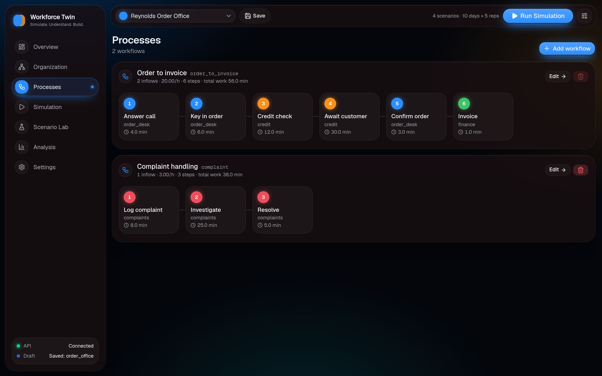

**Processes** (Süreçler) sayfasındaki her kart, adım zinciriyle birlikte bir iş akışıdır (workflow). **Edit** (Düzenle) tuvali açar. **New workflow** (Yeni iş akışı) boş bir iş akışı oluşturur. Kartta ayrıca giriş hızı ve zincirin toplam çalışma süresi görünür.

### 5.1 Tuval

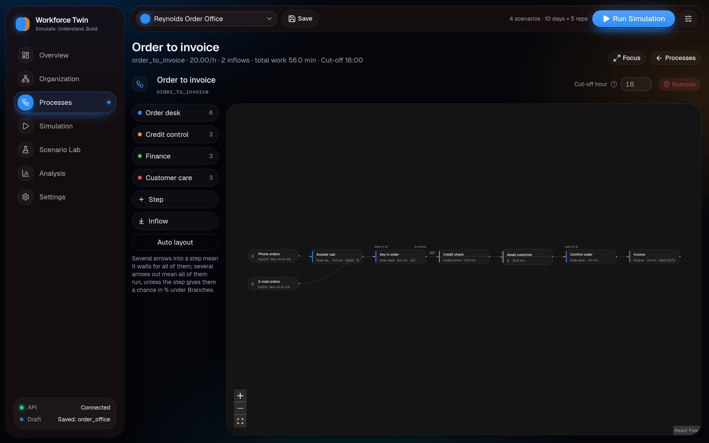

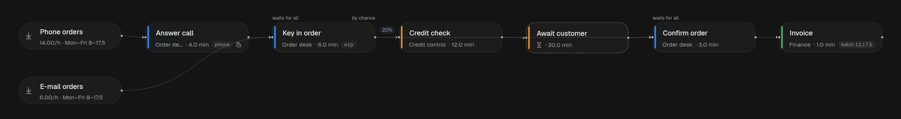

**Canvas** (Tuval), biri size süreci anlatırken onu çizdiğiniz yerdir. Bilerek hoşgörülü tasarlanmıştır: bir adım yalnızca bir adla var olabilir; departman, beceri ve süre sonra doldurulabilir. Eksik adımlar işaretlenir ve **Run** düğmesi neyin eksik olduğunu söyler.

- **Sol palet.** Bir departman çipini tuvale sürükleyerek o departmanda bir adım oluşturun. Bir giriş kanalı eklemek için *Inflow* çipini sürükleyin.
- **Kutular** adımlardır. Renk departmanı gösterir. Kutuda işi kimin yaptığı ve ne kadar sürdüğü yazar.
- **Oklar** "sonra" demektir. Bir adımın alt tutamacından bir sonrakinin üst tutamacına sürükleyin. Bir adıma giren birkaç ok "bunların hepsinden sonra" demektir. Aralarında ok olmayan iki adım paralel çalışır.
- **Inflow düğümleri** kalemlerin girdiği yerlerdir: "Phone orders", "E-mail orders". Her birinin kendi hızı ve saatleri vardır ve beslediği ilk adım(lar)ı gösterir.
- **Focus** (Odak) kenar çubuğunu ve üst çubuğu gizler; tuval pencereye sığar.

Bir kutuya tıklayınca sağda **detail panel** (ayrıntı paneli) açılır.

### 5.2 Adım alanları

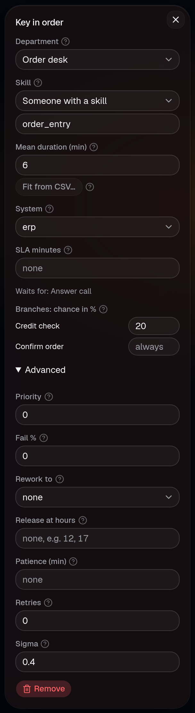

| Alan | Ne girilir | Örnek |
|---|---|---|
| **Name** (Ad) | Adımın ne olduğu. Kimlik (id) bundan türetilir. | Key in order |
| **Department** (Departman) | İşi kimin yaptığı. | Order desk |
| **Skill** (Beceri) | Adımın hangi beceriyi istediği ya da **Waiting (nobody works)** (Bekleme, kimse çalışmaz). | order_entry |
| **Duration** (Süre) | Bir kalem için ortalama çalışma dakikası. Gerçek süreler bunun çevresinde değişir. **Sigma** yayılımdır: 0.1 neredeyse sabit, 1 çok değişken. 0.4 makul bir varsayılandır. | 6 dk, sigma 0.4 |
| **Fit from CSV…** (CSV'den hesapla) | Ortalamayı ve yayılımı aracın gerçek ölçümlerden çıkarmasını sağlar: her satırda bir süre (dakika) olan bir CSV. | |
| **System** (Sistem) | Adımın ihtiyaç duyduğu iş sistemi. | ERP |
| **Branches** (Dallar) | Kalemin sonraki her adıma geçme olasılığı, yüzde olarak. Olasılık verilen adımlar ya biri ya öteki şeklindedir: biri çalışır, ya da 100%'e kalan pay için hiçbiri çalışmaz. Boş, "her zaman" demektir. | Credit check 20% |
| **SLA (min)** (SLA, dk) | Gelişten bu adımın bitişine kadar hedef dakika. Daha geç biten ihlal sayılır. | 60 |
| **Priority** (Öncelik) | *priority* politikasında bir çalışan bekleyen görevler arasında seçim yaparken yüksek olan kazanır. | 0 |
| **Fail %**, **Rework to**, **Retries** (Hata %, Yeniden işleme hedefi, Deneme sayısı) | Adımın başarısız olup kalemin önceki bir adıma geri dönme olasılığı; kalem düşürülmeden önce bunun kaç kez olabileceği. | %10, Investigate'e geri, 1 deneme |
| **Release at hours** (Serbest bırakma saatleri) | Toplu işleme: kalemler, biri onları alabilmeden önce günün bu saatlerinden bir sonrakine kadar bekler. | Öğlen ve 17:30 fatura çalıştırmaları için 12, 17.5 |
| **Patience (min)** (Sabır, dk) | Bir kalemin vazgeçmeden önce kuyrukta beklediği ortalama dakika (arayan kişi telefonu kapatır). Kalem bu durumda **abandoned** (vazgeçen) olur. Boş bırakılırsa sonsuza kadar bekler. | 3 |

### 5.3 Bekleme adımları

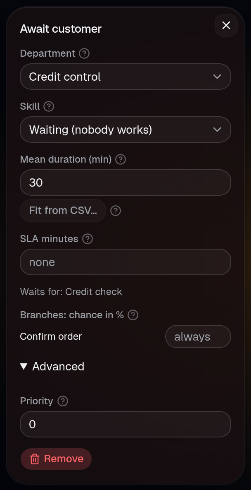

Zaman geçiyor ama ofiste kimse çalışmıyorsa beceri olarak **Waiting (nobody works)** seçin: müşterinin onayını, bir tedarikçi teklifini ya da bir kredi referansını beklemek gibi. Adım yine bir departmana aittir (böylece bekleme süresi bir yere yazılır) ve bir süresi vardır. Ama hiç personel kullanmaz ve asla kuyruğa girmez. Kesik çizgili bir kenarlık ve bir kum saatiyle görünür.

### 5.4 Giriş kanalları ve talep profili

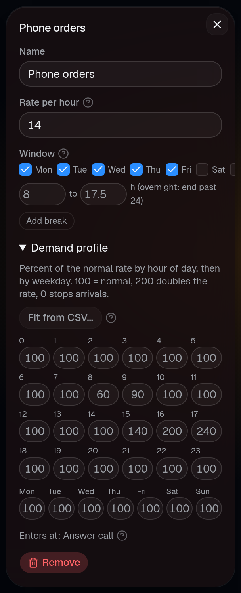

Bir giriş kanalının (inflow) bir **rate** (hız: zaman aralığı açıkken saatte ortalama yeni kalem sayısı), bir **window** (zaman aralığı: kalemlerin geldiği günler ve saatler) ve **entry** (giriş) adımları vardır. Bir kalem üzerindeki iş, zaman aralığı kapandıktan sonra da sürebilir; yalnızca gelişler durur.

Gerçek talep düz değildir. Günün saatine ve haftanın gününe göre şekil vermek için **Demand profile** (Talep profili) bölümünü açın. Değerler **normal hızın yüzdesidir**: `100` normal, `200` o saatte hızı ikiye katlar, `0` gelişleri durdurur. Tipik bir order desk saat 08:00'de %60, kesim saatinden önceki saatte %240 düzeyinde olabilir.

**Fit from CSV…** hızı ve profili geçmiş veriden çıkarır: sipariş sisteminizden sipariş başına bir zaman damgası dışa aktarın (`2026-10-06T09:14:00` gibi ISO biçiminde), her satıra bir tane, ve dosyayı seçin. Araç kaç günde kaç geliş kullandığını bildirir.

### 5.5 Kesim saati

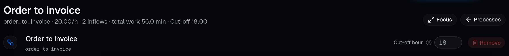

Birçok ofis sürecinde ölçüt "N dakika içinde bitti" değil, "kesim saatinden (cut-off) önce bitti"dir. İş akışının **Cut-off hour** (Kesim saati) değerini girin (örneğin her siparişin 18:00'e kadar faturalanması gerekiyorsa `18`). Bu saatten önce başlayan her kalemin teslim zamanı bugün o saattir. Sonra başlayanların teslim zamanı yarındır. **Missed cut-off %** (Kesimi kaçıran %) rakamı zamanında bitmeyen kalemleri sayar. **Earliest due date** (En erken teslim tarihi) politikası (Bölüm 7) ise personelin önce en acil kalem üzerinde çalışmasını sağlar.

---

## 6. Scenario Lab

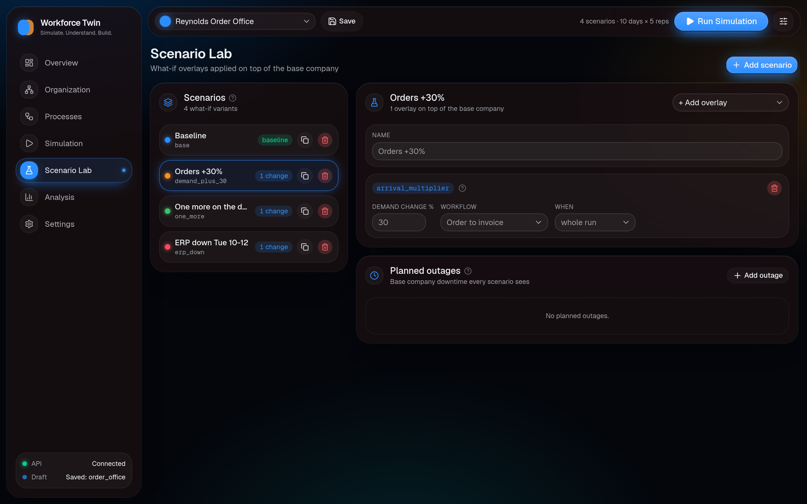

Senaryo, çizdiğiniz ofis artı birkaç **overlay** (değişiklik) demektir: yalnızca o senaryoya uygulanan değişiklikler. **Baseline** senaryosunda hiç değişiklik yoktur. Her çalıştırma tüm senaryoları aynı rastgele çekilişlerle simüle eder. Böylece aralarındaki farklar şanstan değil, değişiklikten gelir.

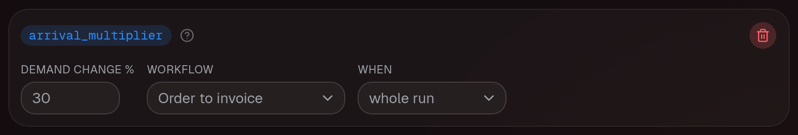

| Değişiklik (overlay) | Ne yapar | Örnek |
|---|---|---|
| **Demand change** (Talep değişimi) | Tek bir iş akışı ya da hepsi için daha fazla ya da daha az iş gelir. Bir yüzde girin: `+30` %30 daha fazla kalem, `-20` %20 daha az kalem demektir. İsterseniz yalnızca bir **time window** (zaman aralığı) içinde uygulanır (mevsimsel bir zirve: 20. günden 40. güne). | Orders +30% |
| **System outage** (Sistem kesintisi) | Bir sistem iki an arasında çalışmaz. Ona ihtiyaç duyan adımlar bekler. | ERP Salı 10:00–12:00 arası çalışmıyor |
| **Add employee** (Çalışan ekle) | Bir departmana becerileri, maliyeti, hızı ve çalışma planıyla bir kişi daha eklenir. | Masaya geçici bir çalışan |
| **Remove resource** (Kaynağı kaldır) | Bir kişi ya da bütün bir havuz yoktur. | Credit control sıfıra iner |
| **Set pool headcount** (Havuz kişi sayısını ayarla) | Havuzda bunun yerine bu kadar kişi vardır. | Desk team 6 yerine 7 |
| **Absence** (Devamsızlık) | Bir kişi iki an arasında yoktur. | Çarşamba günü hastalık izni |

Sayfa ayrıca temel şirketin **planned outages** (planlı kesintiler) listesini de gösterir; bunları her senaryo görür.

İyi senaryoların her biri **tek bir şeyi** değiştirir. "Orders +30%", masanın büyümeyle başa çıkıp çıkamayacağını söyler. "One more on the desk", fazladan kişinin size ne kazandırdığını söyler. İkisi birden daha az şey söyler.

---

## 7. Simulation

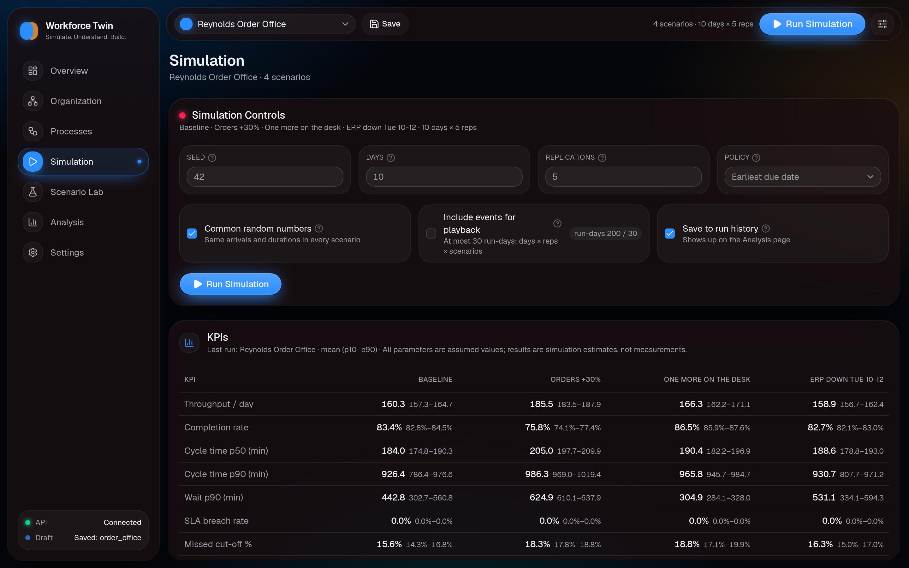

**Simulation** (Simülasyon) sayfası çalıştırdığınız yerdir. Soldaki ayarlar kartı:

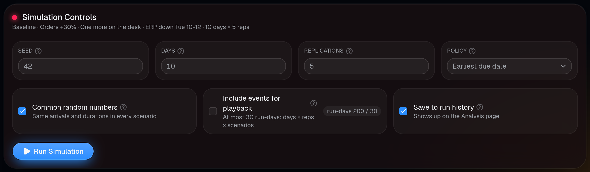

| Ayar | Anlamı | Öneri |
|---|---|---|
| **Seed** (Tohum) | Rastgele çekilişlerin başlangıç noktası. Aynı tohum (seed) aynı sonucu verir. | Olduğu gibi bırakın; farklı bir rastgele hafta görmek için değiştirin. |
| **Days** (Gün) | Çalıştırma başına simüle gün sayısı. | 10–30. Kısa çalıştırmalar gürültülüdür; boş başlayan bir çalıştırmanın dolması bir iki gün sürer. |
| **Replications** (Tekrarlar) | Her senaryonun farklı çekilişlerle kaç kez yeniden çalıştırıldığı. Rakamların ortalaması alınır. | 5–10. Fazlası daha düzgün ama daha yavaştır. |
| **Policy** (Politika) | Boştaki bir çalışanın sıradaki görevi nasıl seçtiği. *priority*: en yüksek adım önceliği önce. *fifo*: en eski önce. *least_loaded*: en uzun kuyruk önce. *edd* (earliest due date, en erken teslim tarihi): kesim saati en yakın olan kalem önce. | Kesim saati kullanıyorsanız *edd*; aksi hâlde *priority*. |
| **Common random numbers** (Ortak rastgele sayılar) | Her senaryo aynı gelişleri ve aynı çalışma sürelerini alır; böylece karşılaştırma yalnızca sizin değişikliğinizi ölçer. | Açık bırakın. |
| **Include events for playback** (Yeniden oynatma için olayları kaydet) | Çalıştırmayı adım adım yeniden oynatabilmeniz için her olayı kaydeder. Yalnızca kısa çalıştırmalar için (gün × tekrar × senaryo ≤ 30). | Karşılaştırmalarda kapalı; bir günün nasıl geçtiğini izlemek istediğinizde açık. |
| **Save run** (Çalıştırmayı kaydet) | Sonucu sunucuda saklar; böylece Analysis sayfasında **Run history** (Çalıştırma geçmişi) altında görünür. | Model oturduktan sonra açık. |

Üst çubukta **Run** düğmesine basın. Birkaç saniye sonra sağ tarafta her senaryo için öne çıkan rakamlar, bir **blocked-time ledger** (engellenen süre defteri: kalemlerin nerede ve neden beklediği; vardiya dışı, herkes meşgul, sistem çalışmıyor, toplu işleme beklemesi) ve olayları kaydettiyseniz zaman kaydırıcılı bir **Playback** (Yeniden oynatma) kartı görünür.

Çalıştırma boyutunun bir sınırı vardır (gün × tekrar × senaryo; varsayılan olarak 2000 çalıştırma-günü). Bunu aşarsanız hata mesajı size sayıları söyler.

---

## 8. Analysis

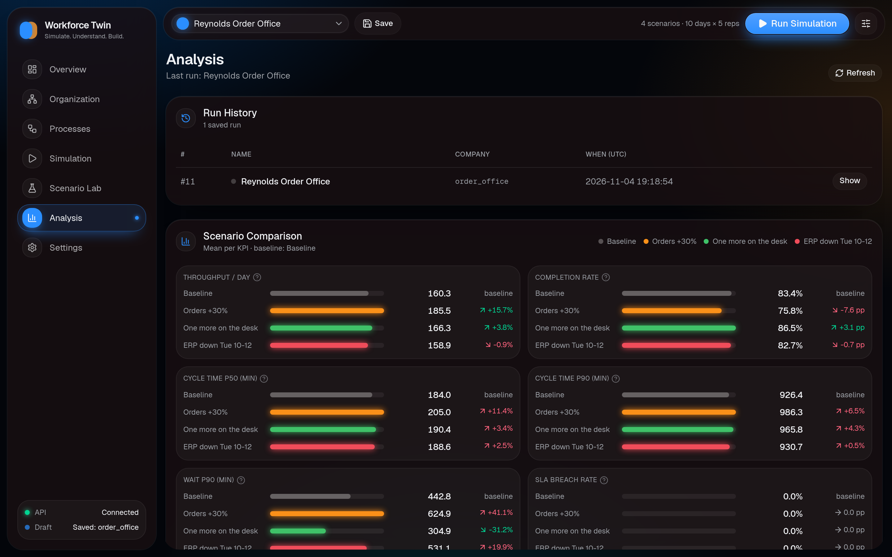

**Analysis** (Analiz) sayfası son çalıştırmanın (ya da **Run history** içindeki kayıtlı bir çalıştırmanın) senaryolarını karşılaştırır. KPI tablosu her rakamı senaryo bazında ve ilk senaryoya göre farkıyla gösterir.

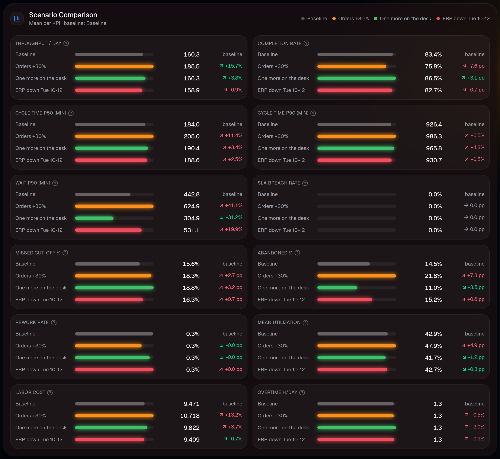

| Rakam | Sade anlamı | Nasıl okunur |
|---|---|---|
| **Throughput / day** (Günlük tamamlanan) | Simüle gün başına tamamlanan kalem. | Yüksek olması iyidir. Günde gelenden düşükse birikmiş iş büyüyordur. |
| **Completion rate** (Tamamlanma oranı) | Gelen kalemlerden çalıştırma içinde bitenlerin payı. | 1'in altındaysa ofis yetişemiyor demektir. |
| **Cycle time p50 / p90** (Çevrim süresi p50 / p90) | Kalemlerin yarısı p50 dakika içinde, %90'ı p90 dakika içinde biter. Kuyrukta bekleme, bekleme adımları ve geceler dahildir. | p90, normal müşterilerinizin en yavaş hizmet alanlarının yaşadığı süredir. |
| **Wait p90** (Bekleme p90) | Boş bir çalışan için beklemelerin %90'ı bundan kısadır. | Tek başına kuyruk. |
| **SLA breach rate** (SLA ihlal oranı) | SLA hedefinden sonra biten adım çalıştırmalarının payı. | |
| **Missed cut-off %** (Kesimi kaçıran %) | İş akışının kesim saatine kadar bitmeyen kalemlerin payı. | Order desk'in rakamı. |
| **Abandoned %** (Vazgeçen %) | Beklemekten vazgeçen (sabrı tükenen) kalemlerin payı. | Kaybedilen aramalar. |
| **Rework rate** (Yeniden işleme oranı) | Başarısız olup yeniden yapılan adım çalıştırmalarının payı. | |
| **Mean utilization** (Ortalama doluluk) | Personelin vardiyaları boyunca meşgul olduğu pay. | 0.75 civarı sağlıklıdır. 1'e yakınsa darboğaz vardır; 0.5'in altı boş kapasitedir. |
| **Labor cost** (İşçilik maliyeti) | Çalışılan saat × saatlik maliyet; fazla mesai, fazla mesai ücretiyle. | |
| **Overtime h/day** (Günlük fazla mesai saati) | Tüm personel için, çalışma planları dışında günde çalışılan saat. | |
| **Cost per completed** (Tamamlanan başına maliyet) | İşçilik maliyeti ÷ tamamlanan kalem. | Verimlilik rakamı. |

Daha aşağıda iki bölüm var. **Utilization per department** (Departman başına doluluk) darboğazın nerede olduğunu gösterir. **Workflow breakdown** (İş akışı dökümü) her iş akışı ve giriş kanalı için bir satır gösterir; böylece telefon siparişlerinin kesim saatini kaçırdığını, e-posta siparişlerinin ise kaçırmadığını görebilirsiniz.

---

## 9. Çözümlü örnek: order desk

Aracı tanımak için bunu on dakikada yeniden kurun. (Bu, kılavuzun yanındaki `example-company.json` dosyasıdır; onu Settings sayfasına da yapıştırabilirsiniz.)

**Ofis.** Dört departman:

- *Order desk*: 6 kişilik havuz, beceriler `phone, order_entry`, £18/sa, fazla mesai +%50, Pzt–Cum 08:00–13:00 ve 14:00–17:30.
- *Credit control*: 3 kişilik havuz, beceri `credit_check`, £22/sa, aynı saatler.
- *Finance*: 3 kişilik havuz, beceri `invoicing`, £22/sa, Pzt–Cum 08:00–13:00 ve 14:00–18:00.
- *Customer care*: 3 kişilik havuz, beceriler `phone, complaint`, £19/sa.

İki sistem: *ERP*, *Phone system*.

**"Order to invoice" iş akışı**, kesim saati 18:00 (her sipariş altıya kadar faturalanmalı), iki giriş kanalı:

- *Phone orders*: saatte 14, Pzt–Cum 08:00–17:30, talep profili 08:00'de %60, 17:00'de %240'a çıkıyor. Giriş: *Answer call*.
- *E-mail orders*: saatte 6, aynı saatler. Giriş: *Key in order*.

Adımlar:

1. **Answer call** — Order desk, `phone`, 4 dk, Phone system, **sabır 3 dk** (arayanlar yaklaşık üç dakika sonra telefonu kapatır).
2. **Key in order** — Order desk, `order_entry`, 6 dk, ERP. **Dal: %20 → Credit check.**
3. **Credit check** — Credit control, `credit_check`, 12 dk.
4. **Await customer** — Credit control, **Waiting (nobody works)**, 30 dk.
5. **Confirm order** — Order desk, `order_entry`, 3 dk, *Key in order* ve *Await customer* adımlarından sonra.
6. **Invoice** — Finance, `invoicing`, 1 dk, **12 ve 17.5'te serbest bırakılır** (faturalar günde iki toplu çalıştırmayla, öğlen ve 17:30'da gönderilir).

**"Complaint handling" iş akışı**: saatte 3, Pzt–Cum 9–17. *Log complaint* (Customer care, `phone`, 8 dk) → *Investigate* (`complaint`, 25 dk, %10 başarısız olur ve bir kez yeniden yapılır) → *Resolve* (`phone`, 5 dk).

**Senaryolar:** Baseline · Orders +30% (yalnızca sipariş iş akışı) · One more on the desk (kişi sayısı 7) · ERP Salı 10:00–12:00 arası çalışmıyor.

**Run**: 10 gün, 5 tekrar, politika *edd*, Common random numbers açık.

**Sonuç nasıl okunur.** Dört senaryo boyunca sipariş iş akışının *Missed cut-off %* (Kesimi kaçıran %) ve *Abandoned %* (Vazgeçen %) değerlerine bakın. Temel senaryoda her altı siparişten biri 18:00 kesimini kaçırıyor, her yedi arayandan biri telefonu kapatıyor. Kesimi kaçıran siparişlerin neredeyse tamamı 16:00–17:30 zirvesinde gelmiş: girilip, kredi kontrolünden geçip onaylanana kadar masa kapanmış oluyor. "One more on the desk" telefon kapatmaları azaltıyor ama kesimi kaçıranları düzeltmiyor; hatta biraz artırıyor, çünkü daha çok çağrı yanıtlanıyor ve daha çok sipariş öğleden sonra darboğazına ulaşıyor. Bu da gecikmenin darboğazının masa olmadığını söylüyor. Darboğaz öğleden sonra zirvesi ve kredi yolu. "Orders +30%" telefon kapatmaları daha da artırıyor. ERP kesintisi Salı günü defterde bir engellenen süre yığını ve o günün tamamlanan sayısında bir düşüş olarak görünüyor. Denenecek sonraki senaryoları sonuç söylüyor: daha geç bir kesim saati, ek bir fatura koşusu ya da daha kısa bir müşteri bekleme süresi.

Sonra tek bir sayıyı değiştirip yeniden çalıştırın. Aracın bütünü bu döngüden ibarettir.

---

## 10. Gerçek sayıları girmek

Model, girdileri kadar iyidir. Değer sırasına göre:

1. **Geliş hızları ve profil.** Dört normal hafta için sipariş/arama başına bir zaman damgası dışa aktarın ve giriş kanalında **Fit from CSV…** kullanın. Bu, tahmine göre en büyük tek iyileştirmedir.
2. **Adım süreleri.** Süre için **Fit from CSV…** kullanmaya adım başına on dürüst kronometre ölçümü yeter. Geçen süreyi değil, *çalışma* süresini kullanın; kuyrukta beklemeyi simülasyon ekler.
3. **Dal yüzdeleri.** Geçen ay kaç siparişin credit check'e gittiğini sayın ve tüm siparişlere bölün.
4. **Çalışma planları, kişi sayıları, kesim saatleri.** Bunları zaten biliyorsunuz.
5. **Sabır.** Telefon sisteminizin kaçırılan arama raporu, telefonu kapatmaya kadar geçen ortalama süreyi verir.

Geri kalan her şey (hata oranları, fazla mesai, kesintiler) yuvarlak bir tahminle başlayabilir ve bir sonuç yanlış göründüğünde iyileştirilebilir.

---

## 11. Kaydetme, yükleme ve paylaşma

- **Save** (üst çubuk) taslağı, API anahtarınızın çalışma alanında, şirket kimliği (id) altında sunucuya kaydeder. Üst çubuktaki şirket seçici kayıtlı şirketleri ve yerleşik *Reynolds* örneğini listeler.
- Tarayıcı, ziyaretler arasında üzerinde çalıştığınız taslağı saklar. Bir taslak yüklenemezse (örneğin bir kuralı sıkılaştıran bir güncellemeden sonra) ayrı bir anahtar altında saklanır ve bir hata mesajı sizi bilgilendirir; hiçbir şey sessizce kaybolmaz.
- **Settings → Raw JSON** (Ham JSON) bütün şirketi ve senaryoları metin olarak gösterir. Bir modeli bir iş arkadaşınızla paylaşmak için kopyalayın; o da yapıştırıp **Apply** düğmesine basar. **Download** (İndir) aynı içeriği dosya olarak kaydeder.

---

## 12. Sınırlar ve iyi alışkanlıklar

- Tüm rakamlar **varsayımlardan çıkan tahminlerdir**. Seçenekleri karşılaştırmak için kullanın, bir hizmet düzeyi vaat etmek için değil.
- Küçük başlayın: tek bir iş akışı, gerçek departmanlar, yuvarlak sayılar. Çalıştırın. Ancak ondan sonra, sonucun hassas olduğu yerlere ayrıntı ekleyin.
- **Senaryo başına tek bir şey** değiştirin.
- Bir farka güvenmeden önce **en az 5 tekrar** çalıştırın; tek bir çalıştırma, rastgele tek bir haftadır.
- Boş başlayan bir çalıştırmanın dolması bir iki gün sürer; 10 gün ya da daha fazlası bunu dengeler.
- Çalışma planı dışındaki saatler: vardiya bitiminde süren bir görev tamamlanır (fazla mesai maliyetiyle); yeni görevler bir sonraki vardiyayı bekler.
- Hafta sonları: bir giriş kanalının zaman aralığı öyle demedikçe hiçbir şey gelmez; bir çalışma planı öyle demedikçe personel izinlidir.
